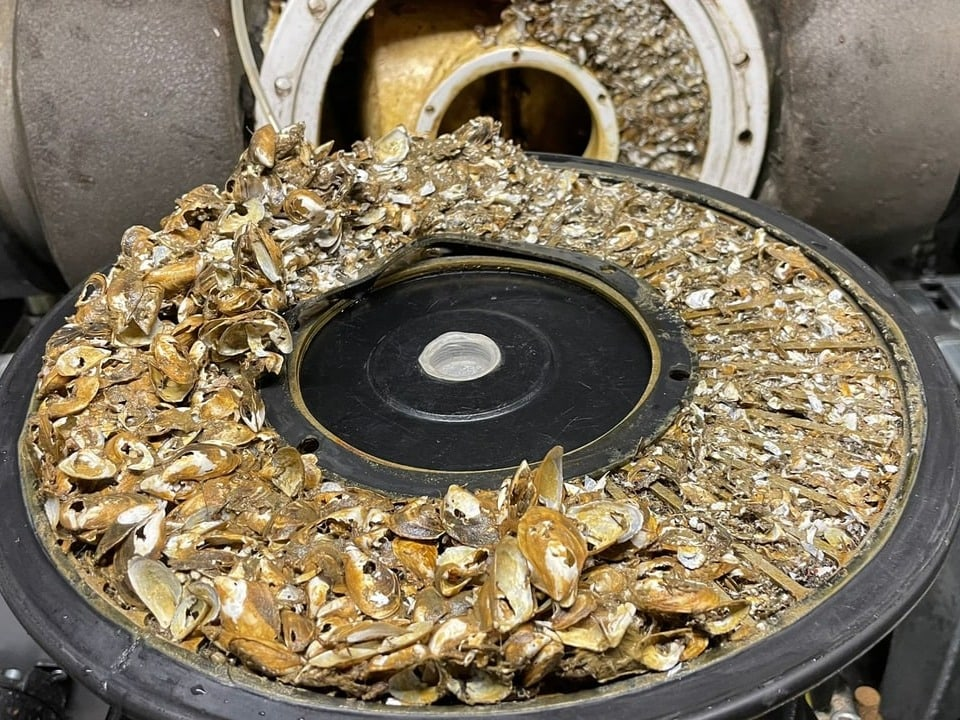
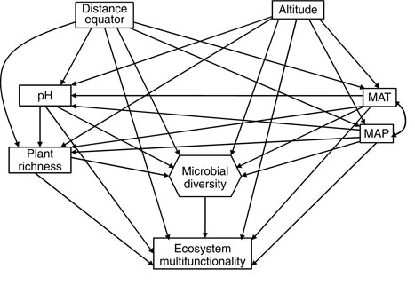
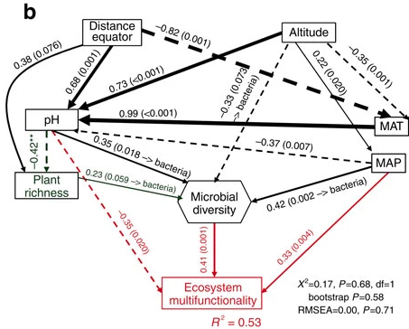
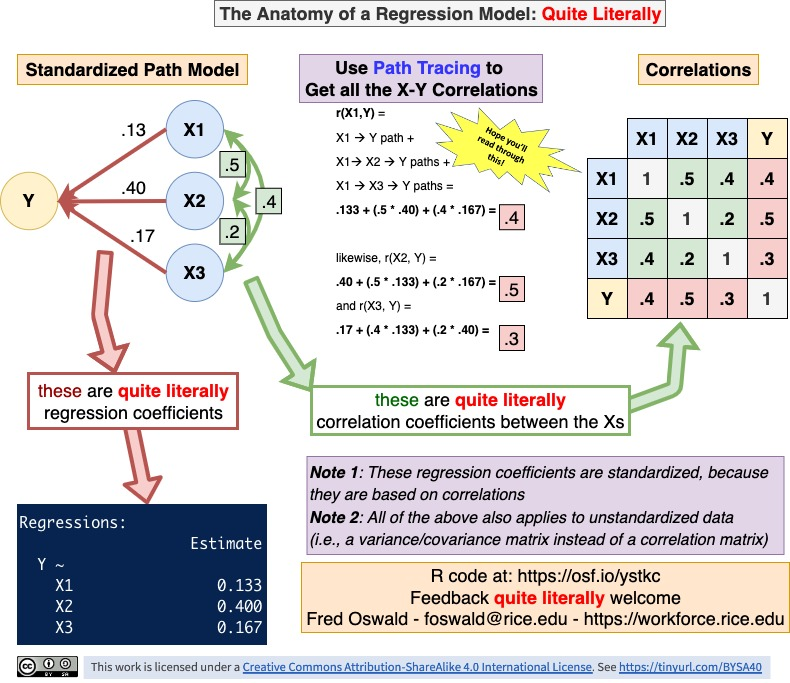
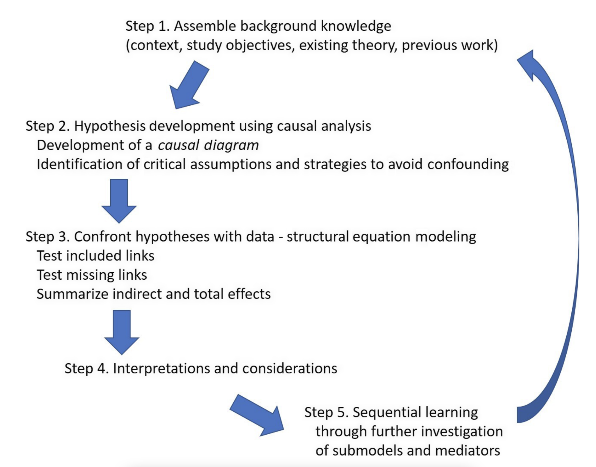

## Quick introduction of participants

-   Who are you?
-   What is your research question?
-   What do you know about path and structural equation modelling already?

# General information

## Acknowledgements {.smaller}

\centering

{width="100%"}

-   Dr. Noémie Pichon, Dr. Fletcher Halliday, Dr. Eliane Meier, Dr. Hugo Saiz, Dr. Debra Zuppinger-Dingley, Rebecca Oester, Annabelle Constance, Fabienne Wiederkehr (course design)
-   Dr. Rachel Korn (course development: exercises and solutions)
-   Dr. Frank Pennekamp (course development: exercises, solutions and slides, instructor)

## Schedule & content {.smaller}

-   *Day 1*:
    -   General introduction to path modelling for ecological systems (lecture)
    -   Fitting path models to data (live demo)
    -   Case study: fitting path models to data (exercises)
    -   Work on your research question / meta-model (self-study)
-   *Day 2*:
    -   Constructs: latent and composite variables (lecture)
    -   Fitting SE models to data (live demo & case study exercises)
    -   Work on your research question / SE model (self-study)
    -   Progress update
-   *Day 3*:
    -   Model visualization (lecture)
    -   Work on your research question / SE model (self-study)
    -   Presentation of your SE model and discussion with instructor and peers

## Overview {.smaller}

-   What the course is about:
    -   Global estimation of path and SE models with R package lavaan (including latents and composites)
    -   Hands-on exercises and live coding
    -   A single ecological dataset for demonstration (Seabloom et al. 2020)
    -   Develop your own model

. . .

-   What will *not* be covered
    -   Local estimation of path and SE models (with R package piecewiseSEM)
    -   Advanced topics:
        -   integrate random effects
        -   disentangle feedback loops
        -   dealing with spatial and temporal autocorrelation

## Learning objectives

You can:

::: incremental
-   translate your research question into a meta-model.
-   fit a path or structural equation model with the R package `lavaan`.
-   assess the quality of a fitted model.
-   interpret your model and those reported by others.
-   present path and SE models graphically.
:::

```{=html}
<!-- ## Course materials

[Slide decks and R code available on github](https://github.com/pennekampster/Swiss_SEM/)
  -->
```

## Understanding (ecological) systems {.smaller}

<!-- Comments: -->

<!-- Each slide represents a concept/topic to teach. Can be expanded to more slides. -->

<!-- Content must be revisited to be consistent in wording, concepts etc. -->

<!-- Specially required feedback on causality, meta-model, backdoor criterion, loops. -->

<!-- Concepts for technical part that could be introduced also here: global vs local, information criteria for arrow selection (for me better on technical part). -->

:::::: incremental
::::: columns
::: {.column width="50%"}
-   Ecological systems characterized by complex causal networks that link environmental gradients, species interactions, and feedback processes across scales
-   Understanding these networks requires analyses that go beyond correlations and can disentangle direct and indirect effects.
-   Testing hypotheses about specific cause-effect relationships in these networks.
:::

::: {.column width="50%"}

:::
:::::
::::::

::: notes
:::

## Why is understanding causes important? {.smaller}

:::::: incremental
::::: columns
::: {.column width="50%"}
-   Causes = mechanisms
-   Allows us to predict the behaviour of a system
-   Justify interventions (e.g., eradication of invasive species, habitat restoration for threatened species)
-   Avoid confounding of cause with non-cause (e.g., avoid interventions with no or detrimental effects)
:::

::: {.column width="40%"}

:::
:::::
::::::

## Causality

> "Correlation does not imply causation"

:::::: incremental
::::: columns
::: {.column width="50%"}
-   Causation: causing variation in X leading to variation in Y (=X causes Y), everything else being equal.
-   Experiments are gold standard to infer causes.
-   However, conducting experiments can be unethical or unfeasible.
-   Can we learn about causality from observational data?
:::

::: {.column width="40%"}

:::
:::::
::::::

::: notes
:::

## "Correlation can indicate causation"

> A simple correlation implies an unresolved causal structure, since we cannot know which is the cause, which is the effect, or even if both are common effects of some third, unmeasured variable.\
> Bill Shipley (Cause and correlation in biology, 2004)

:::::: incremental
::::: columns
::: {.column width="100%"}
-   Inferring causes from observations is possible, but requires to rule out confounding.
-   What is confounding?
:::

::: {.column width="0%"}
:::
:::::
::::::

## Confounding

> Confounding occurs when an outside variable influences both the independent variable (X) and the dependent variable (Y), creating a false impression of a causal relationship between them. This can lead to incorrect conclusions about the nature of the relationship.

```{dot}
digraph confounding_classic {
  rankdir = LR;
  
  node [shape = box, fontname = Helvetica, color = "gray"];
  U [label = "U\n(Unobserved\nConfounder)", color = "red"];
  X [label = "X\n(Predictor)"];
  Y [label = "Y\n(Outcome)"];
  
  U -> X [color = "red", penwidth = 2];
  U -> Y [color = "red", penwidth = 2];
  X -> Y [style = "dashed"];
  
  label = "Example 1: Classic confounding\nU affects both X and Y";
  labelloc = "b";
}

```

## Confounding example

Correlation between ice cream sales and cases of drowning are both influenced by temperature (confounder).

```{r, dev = "png", fig.align='center', .nostretch}

#| out-width: 12in
#| out-height: 3.5in

# Demonstrating Confounding: Ice Cream Sales vs Drowning Deaths
# A classic example showing how correlation does not imply causation

# Load required libraries
library(tidyverse)
library(ggplot2)
library(corrplot)

# Create synthetic data based on realistic patterns
set.seed(42)

# Temperature is the confounder (in Celsius)
temperature <- seq(5, 35, length.out = 12)  # Monthly temperatures

# Ice cream sales increase with temperature
ice_cream_sales <- 100 + 50 * temperature + rnorm(12, 0, 30)
ice_cream_sales <- pmax(ice_cream_sales, 0)  # Ensure non-negative

# Drowning deaths increase with temperature (people swim more)
drowning_deaths <- 10 + 2 * temperature + rnorm(12, 0, 3)

# Create a data frame
data <- tibble(
  month = month.abb,
  temperature = temperature,
  ice_cream_sales = ice_cream_sales,
  drowning_deaths = drowning_deaths
)

# Create scatter plot showing the correlation
scatter_plot <- data %>%
  ggplot(aes(x = ice_cream_sales, y = drowning_deaths)) +
  geom_point(size = 4, color = "steelblue", alpha = 0.7) +
  geom_smooth(method = "lm", se = TRUE, color = "red", fill = "red", alpha = 0.2) +
  labs(
    title = "Ice Cream Sales vs Drowning Deaths",
    subtitle = "Is this causal",
    x = "Ice Cream Sales (arbitrary units)",
    y = "Drowning Deaths (count)",
    caption = paste("Correlation:", round(cor(data$ice_cream_sales, data$drowning_deaths), 3))
  ) +
  theme_minimal() +
  theme(
    plot.title = element_text(face = "bold", size = 14),
    plot.subtitle = element_text(size = 12, color = "darkred"),
    panel.grid = element_line(color = "lightgray")
  )

print(scatter_plot)

```

```{dot}
// Example 2: Ice cream sales and drowning
// Temperature is the confounder
digraph confounding_icecream {
  rankdir = LR;
  
  node [shape = box, fontname = Helvetica, color = "gray"];
  Temperature [label = "Temperature"];
  IceCreamSales [label = "Ice Cream\nSales"];
  Drowning [label = "Drowning\nDeaths"];
  
  Temperature -> IceCreamSales;
  Temperature -> Drowning;
  IceCreamSales -> Drowning [style = "dashed", label = "Spurious correlation"];
  
  labelloc = "b";
}
```

## Path diagrams {.smaller}

A path diagram specifies putative cause-effect relationships — the data-generating mechanisms that lead to a set of observational expectations.

:::::: columns
:::: {.column width="50%"}
::: incremental
-   Nodes = measured variable (box shape).
-   One-headed arrow = causal relationship.
-   Double-headed arrow = non-causal relationship. 
-   Relationships can have any functional shape.
-   Omitted links and nodes have empirical implications (= assumptions about the causal diagram).
-   U = unmeasured cause.
:::
::::

::: {.column width="50%"}
```{dot}
//| fig-width: 5
//| fig-height: 2
digraph {

  # a 'graph' statement
  graph [overlap = true, fontsize = 15, layout = dot, nodesep = 0.5, ranksep = 0.8,
       rankdir = LR];

  # 'node' statements
  node [shape = box,
        fontname = Helvetica];
  Y;

  # 'edge' statements
  W -> Y;
  Z -> Y;
  W -> Z[dir=both, constraint=false, style=dashed]; 

 node [shape = plaintext,
        fontname = Helvetica];
  U_y -> Y;
  U_y [label = <U<SUB>y</SUB>>];
 
 # control the placement of elements on the graph 
 {rank = min; Z ; W;};
 {rank = max; U_y};

  }
```
:::
::::::

## How do we establish causality?

:::::: incremental
::::: columns
::: {.column width="100%"}
-   Build knowledge from past observation (meta-model)
-   Design and conduct an experiment or observational study
-   Test hypotheses
-   Develop/refine theory
:::

::: {.column width="0%"}
:::
:::::
::::::

. . .

> The combination of knowledge of correlations with knowledge of causal relations, to obtain certain results, is a different thing from the deduction of causal relations from correlations.”\
> Sewall Wright, 1923

## The SEM workflow

Evaluates whether the observed data are consistent with a hypothesised causal network, rather than proving causation.

-   Build a hypothesized causal diagram {width="50%"}

## The SEM workflow

Evaluates whether the observed data are consistent with a hypothesised causal network, rather than proving causation.

-   Build a hypothesized causal diagram (meta-model)
-   Collect data

## The SEM workflow

Evaluates whether the observed data are consistent with a hypothesised causal network, rather than proving causation.

-   Build a hypothesized causal diagram (meta-model)
-   Collect data
-   Build SEM and test against data {width="50%"}

## The SEM workflow

Evaluates whether the observed data are consistent with a hypothesised causal network, rather than proving causation.

-   Build a hypothesized causal diagram (meta-model)
-   Collect data
-   Build SEM and test against data {width="50%"}
-   Repeat!

::: notes
https://www.nature.com/articles/ncomms10541
:::

## Biodiversity-ecosystem functioning {background-image="images/meadow.JPG" background-opacity="0.4"}


::::: columns
::: {.column width="40%"}


:::

::: {.column width="60%"}
Meta-model:

```{dot}
//| fig-width: 7
digraph G {

  graph [overlap = false, fontsize = 10, layout = dot, ranksep = .7,
       rankdir = TB]

 impact[label="human impact"]

  bgcolor="transparent"
  impact -> function;
  diversity -> function;
  environment -> function;
  
}
```
:::
:::::


::: notes
This is an example of a meta-model of an ecological system that we might want to understand using SEM. The question could be: how do human impacts affect ecosystem functioning, and what role does biodiversity play in mediating this effect? Please note that the three drivers are general categories, and each can encompass multiple specific variables. How would we analyse the effect of the environment and human impact on functioning?
:::

## Multiple regression {.smaller}

``` r
model <- '
biomass ~ richness + nutrients + disturbance'
sem(model, data = data)
```

```{dot}
//| fig-width: 4
//| fig-height: 4

digraph  {

  # a 'graph' statement
  graph [overlap = false, fontsize = 15, layout = neato, rankdir = LR, splines = curved]

  # 'node' statements
  node [shape = box,
        fontname = Helvetica]
        
  X1 [pos = "0,-1!", label = nutrients]
  X2 [pos = "0,-2!",label = disturbance]
  X3 [pos = "0,-3!",label = richness]
  Y  [pos = "2,-2!",label = biomass]

  # 'edge' statements
  X1 -> Y:w 
  X2 -> Y:w
  X3 -> Y:w
  
  X1:w -> X2:w [constraint=false, dir=both, style=dashed]
  X2:w -> X3:w [dir=both, style=dashed]
  X1:w -> X3:w [dir=both, style=dashed]
  
}

```

::: incremental
-   *Direct* effects of one or more independent variables (X) on a dependent variable (Y).
-   Regression coefficient quantifies the direction and strength of relationship (i.e., how much change in Y for one unit change in X).
-   Partial regression coefficients when more than one independent variable.
-   Strong correlations among predictors may be problematic for interpretation.
:::

<!-- - Discuss with students other variables that may affect B.   -->

<!-- - Introduce a new variable and the question that it answers.  -->

<!-- - Add nutrient variable.  -->

<!-- - Show the graphical model (X1 -> Y, X2 -> Y).  -->

<!-- - Include the equation and the two partial plots.  -->

<!-- - Be clear this is a multiple regression model.  -->

## Biodiversity-ecosystem functioning {background-image="images/meadow.JPG" background-opacity="0.4"}

::::: columns
::: {.column width="40%"}


:::

::: {.column width="50%"}
Meta-model:

```{dot}
//| fig-width: 6
digraph G {

  graph [overlap = false, fontsize = 10, layout = dot, ranksep = .7,
       rankdir = TB]
  impact [label="human impact"]

  bgcolor="transparent"
  environment -> diversity;
  environment -> function;
  impact -> diversity;
  diversity -> function;
  impact -> function;
  
  
  
}
```
:::
:::::


## Path model {.smaller}

``` r
model <- '
richness ~ nutrients + disturbance
biomass ~ richness + nutrients + disturbance'
sem(model, data = data)
```

```{dot}
//| fig-width: 5
//| fig-height: 2

digraph  {

  # a 'graph' statement
  graph [overlap = false, fontsize = 10, layout = dot, splines = curved,
       rankdir = LR]

  # several 'node' statements
  node [shape = box,
        fontname = Helvetica]
        
  nutrients; richness; biomass; disturbance;

  # several 'edge' statements
    nutrients->richness ;
    disturbance->richness ;
    disturbance->biomass ;
    richness->biomass ;
    nutrients->biomass [minlen=3];
    
    {rank=min; nutrients; disturbance;}
    {rank=max; biomass;}
    {rank=same; richness;}
}
```

::: incremental
-   Simultaneously estimates multiple (regression) equations.
-   Allows testing both direct and indirect effects.
-   Exogenous variables (independent variables):
    -   only have out-going paths.\
-   Endogenous variables (response variables):
    -   have in-going and out-going paths.\
:::

## Mediation {.smaller}

::: incremental
-   Tests whether a particular variable has a mediating effect on a path.\
-   Often used to test underlying mechanisms.
-   In our example, we could ask whether the effect of nutrients on biomass is mediated through biodiversity.
-   Possibilities: complete mediation, partial mediation, no mediation.
:::

. . .

::::: columns
::: {.column width="50%"}
```{dot}
//| fig-width: 5
//| fig-height: 2

digraph  {

   label     = "Full mediation"
   labelloc  =  t // t: Place the graph's title on top.
   fontsize  = 20 // Make title stand out by giving a large font size

  # a 'graph' statement
  graph [overlap = false, layout = dot, splines = curved,
       rankdir = LR]

  # several 'node' statements
  node [shape = box,
        fontname = Helvetica]
        
  nutrients; richness; biomass;

  # several 'edge' statements
    nutrients->richness [style=solid];
    richness->biomass [style=solid];
    
    {rank=min; nutrients;}
    {rank=max; biomass;}
    {rank=same; richness;}
}
```
:::

::: {.column width="50%"}
```{dot}
//| fig-width: 5
//| fig-height: 2

digraph  {

   label     = "Partial mediation"
   labelloc  =  t // t: Place the graph's title on top.
   fontsize  = 20 // Make title stand out by giving a large font size

  # a 'graph' statement
  graph [overlap = false, layout = dot, splines = curved,
       rankdir = LR]

  # several 'node' statements
  node [shape = box,
        fontname = Helvetica]
        
  nutrients; richness; biomass;

  # several 'edge' statements
    nutrients->richness [style=solid];
    richness->biomass [style=solid];
    nutrients->biomass [style=solid];

    {rank=min; nutrients;}
    {rank=max; biomass;}
    {rank=same; richness;}
}
```
:::
:::::

```{=html}
<!-- your comment x
## Regression anatomy
{.absolute width="800"}
-->
```

## Motivations to use path model and SE models:

::: incremental
1)  Driver-focused: Understand how drivers influence a system
2)  Response-focused: Understand and explain a particular response of a system\
3)  Mediation-focused: Understand underlying causal pathways\
4)  Theory-focused: compare observations of a system to available theory
:::

## Path and SE modelling philosophy

::: incremental
-   A model should be based on prior evidence / theory (i.e., a meta-model).
-   Each path requires explicit justification: make table with expected directions and magnitudes of paths.
-   Diagram to specify relationships of actual variables and compare with observed data.
-   Make the model as simple as possible: only include paths directly relevant to your research question rather than modelling all possible relationships.
:::

```{=html}
<!-- ## Explanatory modelling with SEM

{width="60%"}

::: aside
[Grace, James B., and Kathryn M. Irvine. 2020. “Scientist’s Guide to Developing Explanatory Statistical Models Using Causal Analysis Principles.” Ecology 101 (4): e02962.]{style="font-size: 5mm; text-align: center"}
::: -->
```

# Questions?

## Exercise

-   Draw a causal diagram of the dataset you want to understand (define nodes and edges).
-   Make a table specifying putative causal relationships.
-   Of what type is your SEM (response, driver, mediation, theory focused)?


