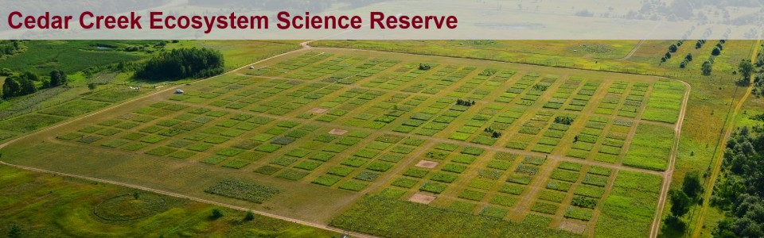
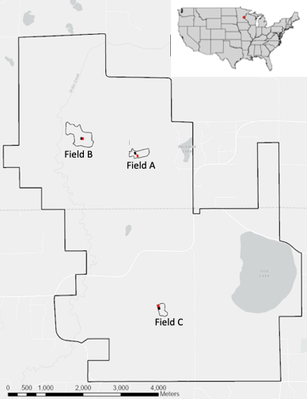
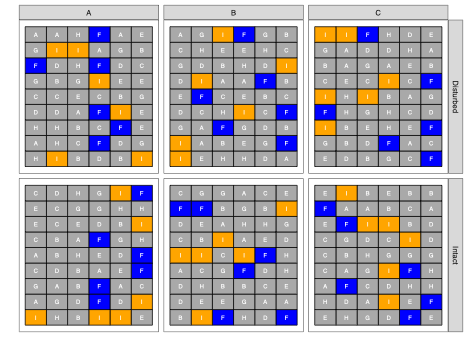
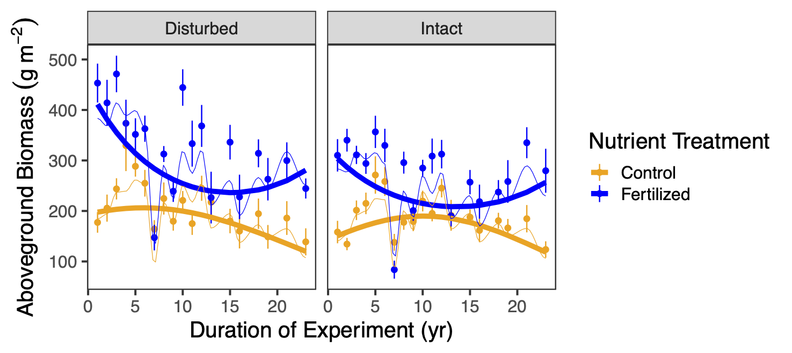

# Your turn: working with the Seabloom dataset

## Introduction to the dataset



-   Experimental grassland study (started in 1982)
-   Long-term consequences of human-driven environmental changes on grasslands:
    -   Soil disturbance (disk harrowing)
    -   Nitrogen deposition 

{.relative width="400" right="400"}


## Introduction to the dataset

::::: columns
::: {.column width="50%"}
{height="700"}
:::

::: {.column width="50%"}
-   Study site located in Minnesota (Cedar Creek Ecosystem Science Reserve).
-   Design:
    -   three study fields within the reserve.
    -   35 x 55 m intact (black) and disturbed (red) plots within each field.
:::
:::::

## Introduction to the dataset {.smaller}

{.relative width="1000" right="200"}

-   4 x 4 m nutrient treatment plots within the intact or disturbed plots (within fields A-C).
-   Letters indicate the nutrient treatments.

## Introduction to the dataset {.smaller}



-   Response variable: aboveground plant biomass.

## Introduction to the dataset {.smaller}

Response variables of interest:     

  A)  Species richness (number of species per 0.3 m$^2$)
  B)  effective number of species (ENS~PIE~)
  C)  Simpsons's evenness (measures the degree of concentration when individuals are classified into types). High values indicate a more even distribution of individuals among the species.

ENS~PIE~ equivalent to $1 / \sum_{i=1}^{S} p_i^2$ where $S$ is the total number of species and $p_i$ is the proportion of the community biomass represented by species $i$.

## Potential research questions

```{dot}
//| fig-width: 8
digraph  {

   # a 'graph' statement
  graph [overlap = false, fontsize = 10, splines = curved, rankdir = LR]

  # several 'node' statements
  node [shape = box,
        fontname = Helvetica]
  
  impact [ label = "human impact" ]

   impact -> biodiversity -> biomass;
   impact -> biomass;
  
}
```

1)  How has aboveground biomass changed as a function of soil disturbance and nutrient addition?
2)  How are these effects mediated by biodiversity?

::: notes
Ask students about how they would address this question.
:::

## The meta-model

```{dot}
//| fig-width: 12
//| fig-height: 5

digraph  {

   # a 'graph' statement
  graph [overlap = false, fontsize = 10, rankdir = LR, ranksep=.8]

  # several 'node' statements
  node [shape = box,
        fontname = Helvetica]
  
   subgraph cluster_bio {
        label="Biodiversity"
        fontname = Helvetica
		    color=lightgrey;
        evenness, richness;
        }


   subgraph cluster_env {
        label="Human impact"
        fontname = Helvetica
     		color=lightgrey;
        nutrients;
        disturbance;
        }

    nutrients->richness;
    nutrients->evenness;
    nutrients->biomass;
    disturbance -> biomass;

   subgraph cluster_prod {
     label="Function";
     fontname = Helvetica;
     color=lightgrey;
     biomass; 
     }

    evenness->biomass ;
    richness->biomass ;
  
}
```

::: incremental
1)  Function (biomass) is directly influenced by human impact (nutrients, disturbance)
2)  Function (biomass) is directly influenced by biodiversity (richness and evenness).
3)  Human impact also influences biodiversity and thus, have an indirect effect on function via biodiversity.
:::

::: notes
:::

## Exercise 1

-   Load the Seabloom dataset and average over the available years(data and code provided)
-   Inspect relationships between the following variables:
    -   nadd, disk, rich, even, ens.pie, mass.above
-   Fit multiple linear regression models to estimate coefficients
    -   direct effects of nadd, disk, rich and even on above ground biomass (AGB)
    -  direct effects of nadd and disk on richness and evenness
    -  check multivariate normality of model residuals (hint: use the function mvn() in the R package MVN)
-   What do you conclude?

## Exercise 2

```{dot}
//| fig-width: 10
//| fig-height: 4

digraph  {

   # a 'graph' statement
  graph [overlap = false, fontsize = 10, rankdir = LR, ranksep=1]

  # several 'node' statements
  node [shape = box,
        fontname = Helvetica, color="gray"]
  
        evenness, richness;
        nutrients;
        disturbance;

    nutrients->richness;
    nutrients->evenness;
    nutrients -> biomass;
    disturbance -> biomass;

   # evenness:e-> richness:e [dir=both; minlen=3] ;

    evenness->biomass ;
    richness->biomass ;
  
 { rank="same"; nutrients; disturbance}
 { rank="same"; evenness; richness}
}
```

-   Fit the above DAG to the Seabloom data:
    -   Assess model goodness of fit.
    -   Investigate the modification indices. Any paths that need adding?
    -   Check model summary.
-   Do you have a valid model?

## Exercise 3

```{dot}
//| fig-width: 10
//| fig-height: 4
digraph  {

   # a 'graph' statement
  graph [overlap = false, fontsize = 10, rankdir = LR, ranksep=1]

  # several 'node' statements
  node [shape = box,
        fontname = Helvetica, color="gray"]
  
        evenness, richness;
        nutrients;
        disturbance;

    nutrients->richness;
    nutrients->evenness;
    nutrients -> biomass;
    disturbance -> biomass;

    evenness:e-> richness:e [dir=both; minlen=3, style="dashed"] ;

    evenness->biomass ;
    richness->biomass ;
  
 { rank="same"; nutrients; disturbance}
 { rank="same"; evenness; richness}
}
```

After finding a model with good fit:

-   Model analysis:
    -   Calculate the standardized coefficients.
    -   Calculate derived quantities (direct, indirect and total effects of nutrient addition on biomass).

## Exercise 4

```{dot}
//| fig-width: 10
//| fig-height: 4

digraph  {

   # a 'graph' statement
  graph [overlap = false, fontsize = 10, rankdir = LR, ranksep=1]

  # several 'node' statements
  node [shape = box,
        fontname = Helvetica, color="gray"]
  
        evenness, richness;
        nutrients;
        disturbance;

    disturbance->richness;
    disturbance->evenness;
    nutrients->richness;
    nutrients->evenness;
    nutrients->biomass;
    disturbance -> biomass;

    evenness:e-> richness:e [dir=both; minlen=3, style="dashed"] ;

    evenness->biomass ;
    richness->biomass ;
  
 { rank="same"; nutrients; disturbance}
 { rank="same"; evenness; richness}
}
```

-   Build the saturated model, then:
    -   AIC comparison with simpler model used in exercise 3. Which one is more parsimonious?
    -   Perform model pruning on saturated model.

## Exercise 5

:::::: columns
::: {.column width="33%"}
Full mediation

```{dot}
//| fig-width: 3
//| fig-height: 4

digraph  {

   # a 'graph' statement
  graph [overlap = false, fontsize = 10, rankdir = LR, ranksep=1]

  # several 'node' statements
  node [shape = box,
        fontname = Helvetica, color="gray"]
  
        evenness, richness;
        nutrients;
        disturbance;

    disturbance->richness;
    disturbance->evenness;

    nutrients->richness;
    nutrients->evenness;
    nutrients -> biomass;

    evenness:e-> richness:e [dir=both; minlen=3, style="dashed"];

    evenness->biomass ;
    richness->biomass ;
  
 { rank="same"; nutrients; disturbance}
 { rank="same"; evenness; richness}
}
```
:::

::: {.column width="33%"}
Partial mediation

```{dot}
//| fig-width: 3
//| fig-height: 4

digraph  {

   # a 'graph' statement
  graph [overlap = false, fontsize = 10, rankdir = LR, ranksep=1]

  # several 'node' statements
  node [shape = box,
        fontname = Helvetica, color="gray"]
  
        evenness, richness;
        nutrients;
    disturbance;

    disturbance->richness;
    disturbance->evenness;
    nutrients->richness;
    nutrients->evenness;
    disturbance -> biomass;
    nutrients -> biomass;

    evenness:e-> richness:e [dir=both; minlen=3, style="dashed"];

    evenness->biomass ;
    richness->biomass ;
  
 { rank="same"; nutrients; disturbance}
 { rank="same"; evenness; richness}
}
```
:::

::: {.column width="33%"}
No mediation

```{dot}
//| fig-width: 3
//| fig-height: 4

digraph  {

   # a 'graph' statement
  graph [overlap = false, fontsize = 10, rankdir = LR, ranksep=1]

  # several 'node' statements
  node [shape = box,
        fontname = Helvetica, color="gray"]
  
        evenness, richness;
        nutrients;
        disturbance;

    nutrients->richness;
    nutrients->evenness;
    disturbance -> biomass;
    nutrients -> biomass;

    evenness:e-> richness:e [dir=both; minlen=3, style="dashed"];

    evenness->biomass ;
    richness->biomass ;
  
 { rank="same"; nutrients; disturbance}
 { rank="same"; evenness; richness}
}
```
:::
::::::

-   Perform mediation analysis:
    -   Is there no, partial, or full mediation of disturbance on biomass via richness and eveness?
    -   Compare model fits.
    -   Which model better represents your data?