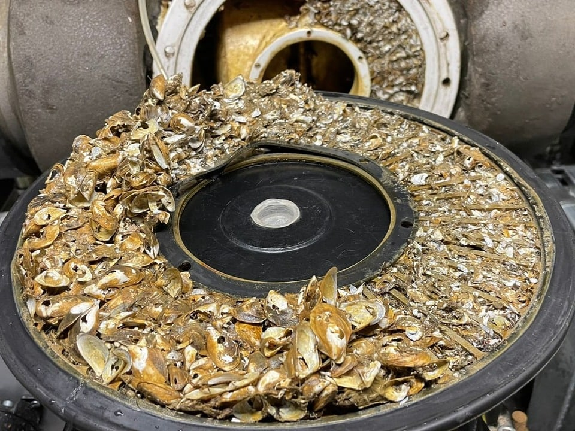
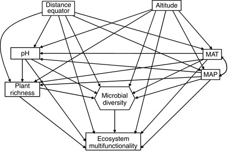
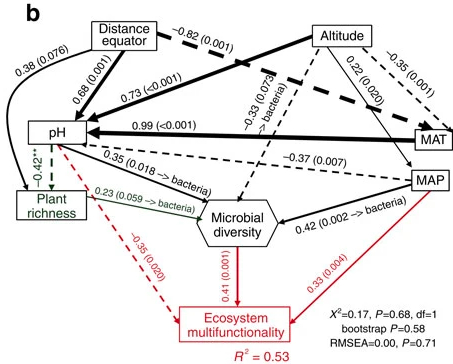
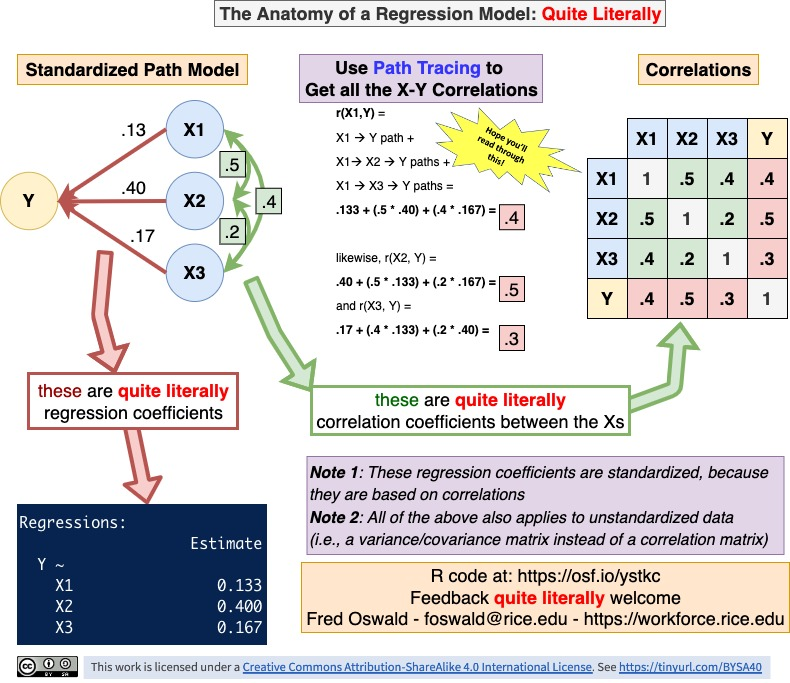
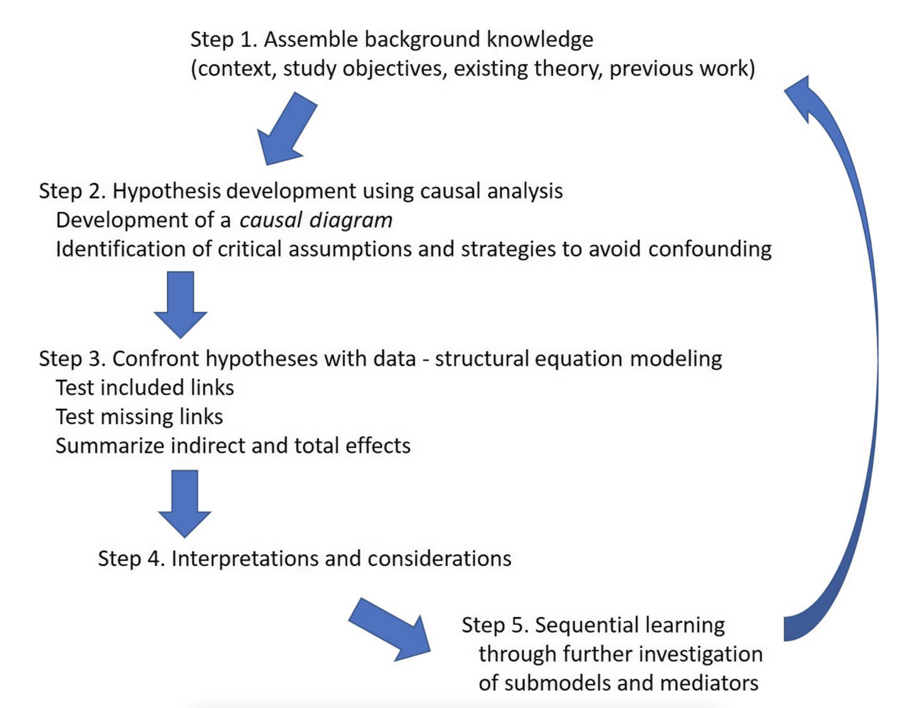
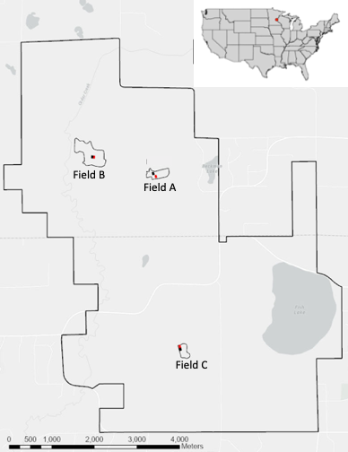
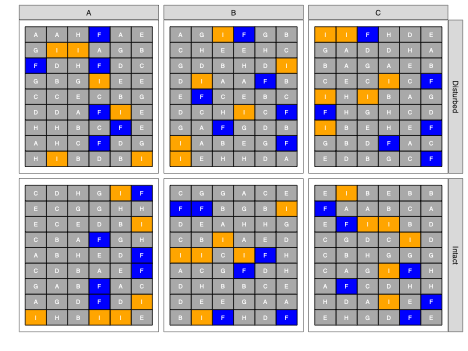
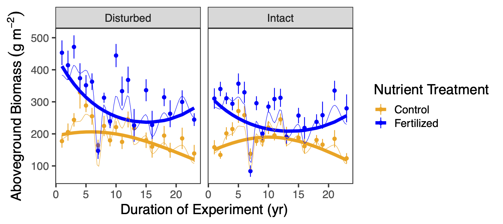

```{r setup, include=FALSE}
knitr::opts_chunk$set(echo = FALSE, fig.align='center')

library(DiagrammeR)
library(ggplot2)
library(knitr)
library(kableExtra)

```

## Quick introduction of participants

-   Who are you?
-   What is your research question?
-   What do you know about path and structural equation modelling already?

# General information

## Acknowledgements {.smaller}

\centering

{width="100%"}

-   Dr. Noémie Pichon, Dr. Fletcher Halliday, Dr. Eliane Meier, Dr. Hugo Saiz, Dr. Debra Zuppinger-Dingley, Rebecca Oester, Annabelle Constance, Fabienne Wiederkehr (course design)
-   Dr. Rachel Korn (course development: exercises and solutions)
-   Dr. Frank Pennekamp (course development: exercises, solutions and slides, instructor)

## Schedule & content {.smaller}

-   *Day 1*:
    -   General introduction to path modelling for ecological systems (lecture)
    -   Fitting path models to data (live demo)
    -   Case study: fitting path models to data (exercises)
    -   Work on your research question / meta-model (self-study)
-   *Day 2*:
    -   Constructs: latent and composite variables (lecture)
    -   Fitting SE models to data (live demo & case study exercises)
    -   Work on your research question / SE model (self-study)
    -   Progress update
-   *Day 3*:
    -   Model visualization (lecture)
    -   Work on your research question / SE model (self-study)
    -   Presentation of your SE model and discussion with instructor and peers

## Overview {.smaller}

-   What the course is about:
    -   Global estimation of SEMs with R package lavaan (including latents and composites)
    -   Hands-on exercises and live coding
    -   A single ecological dataset for demonstration (Seabloom et al. 2020)
    -   Develop your own SE model

. . .

-   What will *not* be covered
    -   Local estimation of SE models (with R package piecewiseSEM)
    -   Advanced topics:
        -   integrate random effects
        -   disentangle feedback loops
        -   dealing with spatial and temporal autocorrelation

## Learning objectives

You can:

::: incremental
-   translate your research question into a meta-model.
-   fit a path or structural equation model with the R package `lavaan`.
-   assess the quality of a fitted path or SE model.
-   interpret your path or SE model and those reported by others.
-   present path and SE models graphically.
:::

```{=html}
<!-- ## Course materials

[Slide decks and R code available on github](https://github.com/pennekampster/Swiss_SEM/)
  -->
```

# Getting started with Structural Equation Modeling

## Understanding (ecological) systems {.smaller}

<!-- Comments: -->

<!-- Each slide represents a concept/topic to teach. Can be expanded to more slides. -->

<!-- Content must be revisited to be consistent in wording, concepts etc. -->

<!-- Specially required feedback on causality, meta-model, backdoor criterion, loops. -->

<!-- Concepts for technical part that could be introduced also here: global vs local, information criteria for arrow selection (for me better on technical part). -->

:::::: incremental
::::: columns
::: {.column width="50%"}
-   Ecological systems characterized by complex causal networks that link environmental gradients, species interactions, and feedback processes across scales
-   Understanding these networks requires analyses that go beyond correlations and can disentangle direct and indirect effects.
-   Testing hypotheses about specific cause-effect relationships in these networks.
:::

::: {.column width="50%"}

:::
:::::
::::::

::: notes
:::

## Why is understanding causes important? {.smaller}

:::::: incremental
::::: columns
::: {.column width="50%"}
-   Causes = mechanisms
    -   Allows us to predict the behaviour of a system
    -   Justify interventions (e.g., eradication of invasive species, habitat restoration for threatened species)
-   What is the problem?
    -   Confounding of cause with non-cause (e.g., avoid interventions with no or detrimental effects)
:::

::: {.column width="40%"}

:::
:::::
::::::

## Causality

> "Correlation does not imply causation"

:::::: incremental
::::: columns
::: {.column width="50%"}
-   Causation: causing variation in X leading to variation in Y (=X causes Y), everything else being equal.
-   Experiments are gold standard to infer causes.
-   However, conducting experiments can be unethical or unfeasible.
-   Can we learn about causality from observational data?
:::

::: {.column width="40%"}

:::
:::::
::::::

::: notes
-   Example shown: is this correlation or causation?
:::

## "Correlation can indicate causation"

> A simple correlation implies an unresolved causal structure, since we cannot know which is the cause, which is the effect, or even if both are common effects of some third, unmeasured variable.\
> Bill Shipley (Cause and correlation in biology, 2004)

:::::: incremental
::::: columns
::: {.column width="100%"}
-   Inferring causes from observations is possible, but requires to rule out confounding.
-   What is confounding?
:::

::: {.column width="0%"}
:::
:::::
::::::

## Confounding

> Confounding occurs when an outside variable influences both the independent variable (X) and the dependent variable (Y), creating a false impression of a causal relationship between them. This can lead to incorrect conclusions about the nature of the relationship.

```{dot}
digraph confounding_classic {
  rankdir = LR;
  
  node [shape = box, fontname = Helvetica, color = "gray"];
  U [label = "U\n(Unobserved\nConfounder)", color = "red"];
  X [label = "X\n(Predictor)"];
  Y [label = "Y\n(Outcome)"];
  
  U -> X [color = "red", penwidth = 2];
  U -> Y [color = "red", penwidth = 2];
  X -> Y [style = "dashed"];
  
  label = "Example 1: Classic Confounding\nU affects both X and Y";
  labelloc = "b";
}

```

## Confounding example

Correlation between ice cream sales and cases of drowning are both influenced by temperature (confounder).

```{r, dev = "png", fig.align='center', .nostretch}

#| out-width: 12in
#| out-height: 3.5in

# Demonstrating Confounding: Ice Cream Sales vs Drowning Deaths
# A classic example showing how correlation does not imply causation

# Load required libraries
library(tidyverse)
library(ggplot2)
library(corrplot)

# Create synthetic data based on realistic patterns
set.seed(42)

# Temperature is the confounder (in Celsius)
temperature <- seq(5, 35, length.out = 12)  # Monthly temperatures

# Ice cream sales increase with temperature
ice_cream_sales <- 100 + 50 * temperature + rnorm(12, 0, 30)
ice_cream_sales <- pmax(ice_cream_sales, 0)  # Ensure non-negative

# Drowning deaths increase with temperature (people swim more)
drowning_deaths <- 10 + 2 * temperature + rnorm(12, 0, 3)

# Create a data frame
data <- tibble(
  month = month.abb,
  temperature = temperature,
  ice_cream_sales = ice_cream_sales,
  drowning_deaths = drowning_deaths
)

# Create scatter plot showing the correlation
scatter_plot <- data %>%
  ggplot(aes(x = ice_cream_sales, y = drowning_deaths)) +
  geom_point(size = 4, color = "steelblue", alpha = 0.7) +
  geom_smooth(method = "lm", se = TRUE, color = "red", fill = "red", alpha = 0.2) +
  labs(
    title = "Ice Cream Sales vs Drowning Deaths",
    subtitle = "Is this causal",
    x = "Ice Cream Sales (arbitrary units)",
    y = "Drowning Deaths (count)",
    caption = paste("Correlation:", round(cor(data$ice_cream_sales, data$drowning_deaths), 3))
  ) +
  theme_minimal() +
  theme(
    plot.title = element_text(face = "bold", size = 14),
    plot.subtitle = element_text(size = 12, color = "darkred"),
    panel.grid = element_line(color = "lightgray")
  )

print(scatter_plot)

```

```{dot}
// Example 2: Ice cream sales and drowning
// Temperature is the confounder
digraph confounding_icecream {
  rankdir = LR;
  
  node [shape = box, fontname = Helvetica, color = "gray"];
  Temperature [label = "Temperature"];
  IceCreamSales [label = "Ice Cream\nSales"];
  Drowning [label = "Drowning\nDeaths"];
  
  Temperature -> IceCreamSales;
  Temperature -> Drowning;
  IceCreamSales -> Drowning [style = "dashed", label = "Spurious correlation"];
  
  labelloc = "b";
}
```

## Causal diagrams (directed acyclic graphs) {.smaller}

A causal diagram specifies putative cause-effect relationships — the data-generating mechanisms that lead to a set of observational expectations.

:::::: columns
:::: {.column width="50%"}
::: incremental
-   Directed = unidirectional.
-   Acyclic = no cycles (=causal loops) permitted.
-   Variables are nodes (boxes).
-   Edges (one-headed arrows) are causal relationships such as X affects Y.\
-   Edges can have any functional shape.
-   Omitted links and nodes have empirical implications (= assumptions about the causal diagram)
-   U variables represent unmeasured causes.
:::
::::

::: {.column width="50%"}
```{dot}
//| fig-width: 4
digraph {

  # a 'graph' statement
  graph [overlap = true, fontsize = 15, layout = dot, ranksep = equally,
       rankdir = Tb];

  # 'node' statements
  node [shape = box,
        fontname = Helvetica];
  X; Y;

  # 'edge' statements
  X -> W;
  X -> Z;
  W -> Y;
  Z -> Y;
  
 node [shape = plaintext,
        fontname = Helvetica];
  U_w  -> W;
  U_x -> X;
  U_y -> Y;
  U_z -> Z;
  
  U_w [label = <U<SUB>w</SUB>>];
  U_x [label = <U<SUB>x</SUB>>];
  U_y [label = <U<SUB>y</SUB>>];
  U_z [label = <U<SUB>z</SUB>>];
 
 
 # control the placement of elements on the graph 
 {rank = min; U_x };
 {rank = same; Z ; W;};
 {rank = max; U_y};

  }
```
:::
::::::

## How do we establish causality?

:::::: incremental
::::: columns
::: {.column width="100%"}
-   Build knowledge from past observation
-   Design and conduct an experiment or observational study
-   Test hypotheses
-   Develop theory
:::

::: {.column width="0%"}
:::
:::::
::::::

. . .

> The combination of knowledge of correlations with knowledge of causal relations, to obtain certain results, is a different thing from the deduction of causal relations from correlations.”\
> Sewell Wright, 1923

## The SEM workflow

Evaluates whether the observed data are consistent with a hypothesised causal network, rather than proving causation.

-   Build a hypothesized causal diagram {width="50%"}

## The SEM workflow

Evaluates whether the observed data are consistent with a hypothesised causal network, rather than proving causation.

-   Build a hypothesized causal diagram
-   Collect data

## The SEM workflow

Evaluates whether the observed data are consistent with a hypothesised causal network, rather than proving causation.

-   Build a hypothesized causal diagram
-   Collect data
-   Build SEM and test against causal diagram {width="50%"}

## The SEM workflow

Evaluates whether the observed data are consistent with a hypothesised causal network, rather than proving causation.

-   Build a hypothesized causal diagram
-   Collect data
-   Build SEM and test against causal diagram {width="50%"}
-   Repeat!

::: notes
https://www.nature.com/articles/ncomms10541
:::

## Biodiversity-ecosystem functioning {background-image="images/meadow.JPG" background-opacity="0.4"}

Meta-model:

```{dot}
//| fig-width: 10
digraph G {

  graph [overlap = false, fontsize = 10, layout = dot, ranksep = .7,
       rankdir = TB]

 impact[label="human impact"]

  bgcolor="transparent"
  impact -> function;
  diversity -> function;
  environment -> function;
  
}
```

::: notes
This is an example of a meta-model of an ecological system that we might want to understand using SEM. The question could be: how do human impacts affect ecosystem functioning, and what role does biodiversity play in mediating this effect? Please note that the three drivers are general categories, and each can encompass multiple specific variables. How would we analyse the effect of the environment and human impact on functioning?
:::

## Multiple regression {.smaller}

``` r
model <- '
biomass ~ richness + nutrients + disturbance'
sem(model, data = data)
```

```{dot}
//| fig-width: 4
//| fig-height: 4

digraph  {

  # a 'graph' statement
  graph [overlap = false, fontsize = 15, layout = neato, rankdir = LR, splines = curved]

  # 'node' statements
  node [shape = box,
        fontname = Helvetica]
        
  X1 [pos = "0,-1!", label = nutrients]
  X2 [pos = "0,-2!",label = disturbance]
  X3 [pos = "0,-3!",label = richness]
  Y  [pos = "2,-2!",label = biomass]

  # 'edge' statements
  X1 -> Y:w 
  X2 -> Y:w
  X3 -> Y:w
  
  X1:w -> X2:w [constraint=false, dir=both, style=dashed]
  X2:w -> X3:w [dir=both, style=dashed]
  X1:w -> X3:w [dir=both, style=dashed]
  
}

```

::: incremental
-   *Direct* effects of one or more independent variables (X) on a dependent variable (Y).
-   Regression coefficient quantifies the direction and strength of relationship (i.e., how much change in Y for one unit change in X).
-   Partial regression coefficients when more than one independent variable.
-   Strong correlations among predictors may be problematic for interpretation.
:::

<!-- - Discuss with students other variables that may affect B.   -->

<!-- - Introduce a new variable and the question that it answers.  -->

<!-- - Add nutrient variable.  -->

<!-- - Show the graphical model (X1 -> Y, X2 -> Y).  -->

<!-- - Include the equation and the two partial plots.  -->

<!-- - Be clear this is a multiple regression model.  -->

## Biodiversity-ecosystem functioning {background-image="images/meadow.JPG" background-opacity="0.4"}

Meta-model:

```{dot}
//| fig-width: 10
digraph G {

  graph [overlap = false, fontsize = 10, layout = dot, ranksep = .7,
       rankdir = TB]
  impact [label="human impact"]

  bgcolor="transparent"
  environment -> diversity;
  environment -> function;
  impact -> diversity;
  diversity -> function;
  impact -> function;
  
  
  
}
```

## Path model {.smaller}

``` r
model <- '
richness ~ nutrients + disturbance
biomass ~ richness + nutrients + disturbance'
sem(model, data = data)
```

```{dot}
//| fig-width: 5
//| fig-height: 2

digraph  {

  # a 'graph' statement
  graph [overlap = false, fontsize = 10, layout = dot, splines = curved,
       rankdir = LR]

  # several 'node' statements
  node [shape = box,
        fontname = Helvetica]
        
  nutrients; richness; biomass; disturbance;

  # several 'edge' statements
    nutrients->richness ;
    disturbance->richness ;
    disturbance->biomass ;
    richness->biomass ;
    nutrients->biomass [minlen=3];
    
    {rank=min; nutrients; disturbance;}
    {rank=max; biomass;}
    {rank=same; richness;}
}
```

::: incremental
-   Simultaneously estimates multiple (regression) equations.
-   Allows testing both direct and indirect effects.
-   Exogenous variables (independent variables):
    -   only have out-going paths.\
-   Endogenous variables (response variables):
    -   have in-going paths
    -   can have out-going paths.\
:::

## Mediation {.smaller}

::: incremental
-   Tests whether a particular variable has a mediating effect on a path.\
-   Often used to test underlying mechanisms.
-   In our example, we could ask whether the effect of nutrients on biomass is mediated through biodiversity.
-   Possibilities: complete mediation, partial mediation, no mediation.
:::

. . .

::::: columns
::: {.column width="50%"}
```{dot}
//| fig-width: 5
//| fig-height: 2

digraph  {

   label     = "Full mediation"
   labelloc  =  t // t: Place the graph's title on top.
   fontsize  = 20 // Make title stand out by giving a large font size

  # a 'graph' statement
  graph [overlap = false, layout = dot, splines = curved,
       rankdir = LR]

  # several 'node' statements
  node [shape = box,
        fontname = Helvetica]
        
  nutrients; richness; biomass;

  # several 'edge' statements
    nutrients->richness [style=solid];
    richness->biomass [style=solid];
    
    {rank=min; nutrients;}
    {rank=max; biomass;}
    {rank=same; richness;}
}
```
:::

::: {.column width="50%"}
```{dot}
//| fig-width: 5
//| fig-height: 2

digraph  {

   label     = "Partial mediation"
   labelloc  =  t // t: Place the graph's title on top.
   fontsize  = 20 // Make title stand out by giving a large font size

  # a 'graph' statement
  graph [overlap = false, layout = dot, splines = curved,
       rankdir = LR]

  # several 'node' statements
  node [shape = box,
        fontname = Helvetica]
        
  nutrients; richness; biomass;

  # several 'edge' statements
    nutrients->richness [style=solid];
    richness->biomass [style=solid];
    nutrients->biomass [style=solid];

    {rank=min; nutrients;}
    {rank=max; biomass;}
    {rank=same; richness;}
}
```
:::
:::::

```{=html}
<!-- your comment x
## Regression anatomy
{.absolute width="800"}
-->
```

## Motivations to use path models:

::: incremental
1)  Driver-focused: Understand how drivers influence a system
2)  Response-focused: Understand and explain a particular response of a system\
3)  Mediation-focused: Understand underlying causal pathways\
4)  Theory-focused: compare observations of a system to available theory
:::

## SE modelling philosophy

::: incremental
-   A SE model should be specified based on prior evidence / theory (i.e., a meta-model).
-   Each path requires explicit justification.
-   DAG to specify relationships of actual variables and compare with observed data.
:::

```{=html}
<!-- ## Explanatory modelling with SEM

{width="60%"}

::: aside
[Grace, James B., and Kathryn M. Irvine. 2020. “Scientist’s Guide to Developing Explanatory Statistical Models Using Causal Analysis Principles.” Ecology 101 (4): e02962.]{style="font-size: 5mm; text-align: center"}
::: -->
```

# Questions?

## Exercise

-   Your turn!
-   What type is your SEM (response, driver, mediation, theory focused)?
-   Draw a causal diagram of the dataset you want to understand (define nodes and edges).
-   Make a table with putative causal relationships.

# Path and SE model fitting

## How to estimate path and SE models?

::: incremental
-   Path and structural equation modelling is a framework rather than a statistical technique.\
-   Global estimation: based on variance-covariance matrix.\
-   Lavaan uses Maximum likelihood estimation (ML).\
-   Lavaan makes several assumptions:
    -   (Multivariate) normality of endogenous (but not exogenous!) variables required
    -   Only acyclic relationships (no loops)
    -   Linear relationships among variables
:::

# Global estimation in a nutshell

## Observed variables and their relationships {.smaller}

```{r, out.width="90%", fig.align='center'}
set.seed(5)
x <- rnorm(500, sd=runif(500, 2, 50))
x2 <- 0.5 *x + rnorm(500, sd=runif(500, 2, 50))
d <- matrix(c(round(x, 2),round(x2, 2)), 250)
colnames(d) <-   c("X1","X2", "X3", "Y")

panel_regression_line = function(x,y, ...){
  points(x,y,...)
  linear_regression = lm(y~x)
  linear_regression_line = abline(linear_regression)
}


pairs(d, pch = 19, lower.panel=panel_regression_line, upper.panel = panel_regression_line)
```

Scatter plots of observed variables and fitted lines.

## Estimated variance-covariance matrix {.smaller}

```{r}
set.seed(5)
x <- rnorm(500, sd=runif(500, 2, 50))
x2 <- 0.5 *x + rnorm(500, sd=runif(500, 2, 50))
d <- matrix(c(round(x, 2),round(x2, 2)), 250)
V <- cov(d)
colnames(V)  <- c("X1","X2", "X3", "Y")
rownames(V)  <- c("X1","X2", "X3", "Y")
kable(V, digits = 2)
```

-   Variances on the diagonal, covariances on the off-diagonal elements

. . .

-   Variance: $VAR_{x}=\frac{\sum_{i=1}^{N}(x_{i}-\bar{x})^2}{N-1}$
    -   Variance is the degree of spread in a set of data.

. . .

-   Covariance: $COV_{x,y}=\frac{\sum_{i=1}^{N}(x_{i}-\bar{x})(y_{i}-\bar{y})}{N-1}$
    -   Covariance measures how much two variables are moving together.

## Correlation matrix estimated from data {.smaller}

```{r}
set.seed(5)
x <- rnorm(500, sd=runif(500, 2, 50))
x2 <- 0.5 *x + rnorm(500, sd=runif(500, 2, 50))
d <- matrix(c(x,x2), 250)
V <- cov(d)
colnames(V)  <- c("X1","X2", "X3", "Y")
rownames(V)  <- c("X1","X2", "X3", "Y")
kable(cov2cor(V),  digits = 2)
```

-   Correlation: $COR_{x,y}=\frac{COV_{x,y}}{\sigma_x*\sigma_y}$
    -   Correlation matrix is standardized variance-covariance matrix

# Path tracing rules - deriving coefficients from correlations

```{r worked-setup, include=FALSE}
knitr::opts_chunk$set(echo = FALSE, fig.align = 'center')
library(knitr)
library(kableExtra)

# Standardized path coefficients used throughout
r <- 0.30   # X1 <-> X2 (exogenous correlation)
a <- 0.60   # X1 -> Y1
b <- 0.40   # X2 -> Y1
c <- 0.50   # Y1 -> Y2
d <- 0.30   # X1 -> Y2 (direct)

# Implied correlation matrix as a table, optionally highlighting cells (worked example)
mat_tab <- function(hl = list()) {
  Mc <- formatC(M, format = "f", digits = 3)
  dimnames(Mc) <- dimnames(M)
  for (cell in hl) {
    Mc[cell[1], cell[2]] <- cell_spec(Mc[cell[1], cell[2]], format = "html", background = "#ffe3e3", bold = TRUE)
    if (cell[1] != cell[2])
      Mc[cell[2], cell[1]] <- cell_spec(Mc[cell[2], cell[1]], format = "html", background = "#ffe3e3", bold = TRUE)
  }
  kable(Mc, format = "html", escape = FALSE, align = "c") |>
    kable_styling(full_width = FALSE, bootstrap_options = "bordered", font_size = 20)
}
```

## The idea behind path tracing

> Sewall Wright (1918, 1934): the correlation between any two variables can be **decomposed** into the paths that connect them in a causal diagram.

{fig-align="center"}

::: incremental
-   Each path in the diagram carries a coefficient.
-   A correlation is rebuilt by **summing** over the routes that connect two variables, **multiplying** the coefficients **along** each route.
-   Fitting a structural equation (SE) model reverses this logic: finding the coefficients whose implied correlations match the observed ones.
:::


## The model we will use {.smaller}

```{dot}
//| fig-width: 7
//| fig-height: 4.5
digraph {
  graph [rankdir = LR, fontsize = 14, ranksep = 1.1, nodesep = 0.7]

  node [shape = box, fontname = Helvetica]
  X1 [label = <X<SUB>1</SUB>>]
  X2 [label = <X<SUB>2</SUB>>]
  Y1 [label = <Y<SUB>1</SUB>>]
  Y2 [label = <Y<SUB>2</SUB>>]

  node [shape = plaintext, fontname = Helvetica]
  z1 [label = <&zeta;<SUB>1</SUB>>]
  z2 [label = <&zeta;<SUB>2</SUB>>]

  X1 -> Y1 [label = "a"]
  X2 -> Y1 [label = "b"]
  Y1 -> Y2 [label = "c"]
  X1 -> Y2 [label = "d"]
  X1 -> X2 [dir = both, constraint = false, label = "r", style = dashed]

  z1 -> Y1
  z2 -> Y2
  {rank = min; X1; X2}
  {rank = max; Y2}
}
```

::: incremental
-   **X₁, X₂** are exogenous and **correlated** (double-headed arrow).
-   **Y₁, Y₂** are endogenous variables, **Y₁** is a mediator with two causes; **Y₂** is the outcome.
-   **X₁** affects Y₂ **directly** *and* **indirectly** through Y₁.
-   Coefficients are **standardized**, so traced routes give **correlations** directly.
:::


## Rule 1: exogenous correlations {.smaller}

An unspecified relationship between two exogenous variables is their **bivariate correlation**, drawn as a double-headed arrow (`r`).

```{dot}
//| fig-width: 6.5
//| fig-height: 3.3

digraph {
  graph [rankdir = LR, fontsize = 14, ranksep = 1.0, nodesep = 0.65]
  
  node [shape = box, fontname = Helvetica, color = "gray65", fontcolor = "gray30"]
  X1 [label = <X<SUB>1</SUB>>]; 
  X2 [label = <X<SUB>2</SUB>>]
  Y1 [label = <Y<SUB>1</SUB>>]; 
  Y2 [label = <Y<SUB>2</SUB>>]
  
  node [shape = plaintext, color = "gray65", fontcolor = "gray55"]
  z1 [label = <&zeta;<SUB>1</SUB>>]; z2 [label = <&zeta;<SUB>2</SUB>>]
  
  edge [color = "gray70", fontcolor = "gray55"]
  X1 -> Y1 [label = "a"]; X2 -> Y1 [label = "b"]
  Y1 -> Y2 [label = "c"]; X1 -> Y2 [label = "d"]
  X1 -> X2 [dir = both, constraint = false, label = "r", color = "#cc0000", penwidth = 2.6, fontcolor = "#cc0000", style = dashed]
  
  z1 -> Y1; z2 -> Y2
  {rank = min; X1; X2}
  {rank = max; Y2}
}
```

## Rule 2: single paths {.smaller}

Imagine path d does not exist. For two variables joined by a **single** directed arrow: the path *is* the regression coefficient (`c`). For standardized data it equals their **correlation**.

```{dot}
//| fig-width: 6.5
//| fig-height: 3.3
digraph {
  graph [rankdir = LR, fontsize = 14, ranksep = 1.0, nodesep = 0.65]
  node [shape = box, fontname = Helvetica, color = "gray65", fontcolor = "gray30"]
  X1 [label = <X<SUB>1</SUB>>]; X2 [label = <X<SUB>2</SUB>>]
  Y1 [label = <Y<SUB>1</SUB>>]; Y2 [label = <Y<SUB>2</SUB>>]
  node [shape = plaintext, color = "gray65", fontcolor = "gray55"]
  z1 [label = <&zeta;<SUB>1</SUB>>]; z2 [label = <&zeta;<SUB>2</SUB>>]
  edge [color = "gray70", fontcolor = "gray55"]
  X1 -> Y1 [label = "a"]; X2 -> Y1 [label = "b"]
  X1 -> Y2 [label = "d"]
  X1 -> X2 [dir = both, constraint = false, label = "r", style = dashed]
  Y1 -> Y2 [label = "c", color = "#cc0000", penwidth = 2.6, fontcolor = "#cc0000"]
  z1 -> Y1; z2 -> Y2
  {rank = min; X1; X2}
  {rank = max; Y2}
}
```

Convention:\
**γ** for exogenous → endogenous (`a, b, d`).\
**β** for endogenous → endogenous (`c`).

## Rule 3: compound paths {.smaller}

A route through intermediate variables is the **product** of its coefficients — the indirect effect of X₁ on Y₂ runs `X1 → Y1 → Y2` and equals **a · c**.

```{dot}
//| fig-width: 6.5
//| fig-height: 3.2
digraph {
  graph [rankdir = LR, fontsize = 14, ranksep = 1.0, nodesep = 0.65]
  node [shape = box, fontname = Helvetica, color = "gray65", fontcolor = "gray30"]
  X1 [label = <X<SUB>1</SUB>>]; X2 [label = <X<SUB>2</SUB>>]
  Y1 [label = <Y<SUB>1</SUB>>]; Y2 [label = <Y<SUB>2</SUB>>]
  node [shape = plaintext, color = "gray65", fontcolor = "gray55"]
  z1 [label = <&zeta;<SUB>1</SUB>>]; z2 [label = <&zeta;<SUB>2</SUB>>]
  edge [color = "gray70", fontcolor = "gray55"]
  X2 -> Y1 [label = "b"]; X1 -> Y2 [label = "d"]
  X1 -> X2 [dir = both, constraint = false, label = "r", style = dashed]
  X1 -> Y1 [label = "a", color = "#cc0000", penwidth = 2.6, fontcolor = "#cc0000"]
  Y1 -> Y2 [label = "c", color = "#cc0000", penwidth = 2.6, fontcolor = "#cc0000"]
  z1 -> Y1; z2 -> Y2
  {rank = min; X1; X2}
  {rank = max; Y2}
}
```

## Rule 4: partial coefficients for multiple paths {.smaller}

When a variable has **several** causes, each path is a **partial** regression coefficient — it controls for the others.

```{dot}
//| fig-width: 6.0
//| fig-height: 2.6
digraph {
  graph [rankdir = LR, fontsize = 14, ranksep = 1.0, nodesep = 0.65]
  node [shape = box, fontname = Helvetica, color = "gray65", fontcolor = "gray30"]
  X1 [label = <X<SUB>1</SUB>>]; X2 [label = <X<SUB>2</SUB>>]
  Y1 [label = <Y<SUB>1</SUB>>]; Y2 [label = <Y<SUB>2</SUB>>]
  node [shape = plaintext, color = "gray65", fontcolor = "gray55"]
  z1 [label = <&zeta;<SUB>1</SUB>>]; z2 [label = <&zeta;<SUB>2</SUB>>]
  edge [color = "gray70", fontcolor = "gray55"]
  X1 -> Y1 [label = "a"]; X2 -> Y1 [label = "b"]
  X1 -> X2 [dir = both, constraint = false, label = "r", style = dashed]
  Y1 -> Y2 [label = "c", color = "#cc0000", penwidth = 2.6, fontcolor = "#cc0000"]
  X1 -> Y2 [label = "d", color = "#cc0000", penwidth = 2.6, fontcolor = "#cc0000"]
  z1 -> Y1; z2 -> Y2
  {rank = min; X1; X2}
  {rank = max; Y2}
}
```

For the two causes of Y₂ (Y₁ and X₁): $$ \beta_{X_1 \rightarrow Y_2} = \frac{r_{X_1,Y_2} - r_{X_1,Y_1}\, r_{Y_1,Y_2}}{1 - r_{X_1,Y_1}^2} $$

## Rule 5: endogenous errors {.smaller}

Every endogenous variable carries an error (disturbance) term, denoted by ζ, for unexplained variance. Its variance is $1 - R^2$ and the standardized error path is $\zeta = \sqrt{1 - R^2}$.

```{dot}
//| fig-width: 6.5
//| fig-height: 3.3
digraph {
  graph [rankdir = LR, fontsize = 14, ranksep = 1.0, nodesep = 0.65]
  node [shape = box, fontname = Helvetica, color = "gray65", fontcolor = "gray30"]
  X1 [label = <X<SUB>1</SUB>>]; X2 [label = <X<SUB>2</SUB>>]
  Y1 [label = <Y<SUB>1</SUB>>]; Y2 [label = <Y<SUB>2</SUB>>]
  node [shape = plaintext, fontname = Helvetica, color = "#cc0000", fontcolor = "#cc0000"]
  z1 [label = <&zeta;<SUB>1</SUB>>]; z2 [label = <&zeta;<SUB>2</SUB>>]
  edge [color = "gray70", fontcolor = "gray55"]
  X1 -> Y1 [label = "a"]; X2 -> Y1 [label = "b"]
  Y1 -> Y2 [label = "c"]; X1 -> Y2 [label = "d"]
  X1 -> X2 [dir = both, constraint = false, label = "r", style = dashed]
  z1 -> Y1 [color = "#cc0000", penwidth = 2.6]
  z2 -> Y2 [color = "#cc0000", penwidth = 2.6]
  {rank = min; X1; X2}
  {rank = max; Y2}
}
```

## Rule 6: residual correlations (partial correlation) {.smaller}

If two endogenous variables share an **unmeasured** cause, their **partial** correlation (after removing shared predictors) is drawn as a double-headed arrow between their **errors** (ψ). This needs a **sibling** structure — it cannot coexist with a direct `Y₁ → Y₂` path.

::::: columns
::: {.column width="42%"}
```{dot}
//| fig-width: 4
//| fig-height: 3
digraph {
  graph [rankdir = LR, fontsize = 14, nodesep = 0.5, ranksep = 0.8]
  node [shape = box, fontname = Helvetica, color = "gray65", fontcolor = "gray30"]
  X; Y1 [label = <Y<SUB>1</SUB>>]; Y2 [label = <Y<SUB>2</SUB>>]
  node [shape = plaintext, color = "gray65", fontcolor = "gray55"]
  z1 [label = <&zeta;<SUB>1</SUB>>]; z2 [label = <&zeta;<SUB>2</SUB>>]
  edge [color = "gray70", fontcolor = "gray55"]
  X -> Y1; X -> Y2
  z1 -> z2 [dir = both, constraint = false, label = "ψ", color = "#cc0000", penwidth = 2.6, fontcolor = "#cc0000", style = dashed]
  z1 -> Y1; z2 -> Y2
  {rank = same; Y1; Y2}
  {rank = max; z1; z2}
}
```
:::

::: {.column width="58%"}
$$ r_{Y_1,Y_2} = \underbrace{\gamma_1 \gamma_2}_{\text{shared cause } X} + \underbrace{\psi}_{\text{partial corr.}} $$

If Y₁ and Y₂ are conditionally independent given X, then ψ = 0 and their correlation is just $\gamma_1\gamma_2$.
:::
:::::

## Rule 7: total effects {.smaller}

The total effect of one variable on another is the **sum of its direct and indirect effects**.

$$ \text{total}(X_1 \rightarrow Y_2) = \underbrace{d}_{\text{direct}} + \underbrace{a\,c}_{\text{indirect}} $$

```{dot}
//| fig-width: 6.0
//| fig-height: 2.6
digraph {
  graph [rankdir = LR, fontsize = 14, ranksep = 1.0, nodesep = 0.65]
  node [shape = box, fontname = Helvetica, color = "gray65", fontcolor = "gray30"]
  X1 [label = <X<SUB>1</SUB>>]; X2 [label = <X<SUB>2</SUB>>]
  Y1 [label = <Y<SUB>1</SUB>>]; Y2 [label = <Y<SUB>2</SUB>>]
  node [shape = plaintext, color = "gray65", fontcolor = "gray55"]
  z1 [label = <&zeta;<SUB>1</SUB>>]; z2 [label = <&zeta;<SUB>2</SUB>>]
  edge [color = "gray70", fontcolor = "gray55"]
  X2 -> Y1 [label = "b"]
  X1 -> X2 [dir = both, constraint = false, label = "r", style = dashed]
  X1 -> Y1 [label = "a", color = "#cc0000", penwidth = 2.6, fontcolor = "#cc0000"]
  Y1 -> Y2 [label = "c", color = "#cc0000", penwidth = 2.6, fontcolor = "#cc0000"]
  X1 -> Y2 [label = "d", color = "#cc0000", penwidth = 2.6, fontcolor = "#cc0000"]
  z1 -> Y1; z2 -> Y2
  {rank = min; X1; X2}
  {rank = max; Y2}
}
```

## Rule 8: total effect ≠ total correlation {.smaller}

The correlation also contains **undirected** routes (through the exogenous correlation).\
[**Causal**]{style="color:#cc0000;"} routes + [**non-causal**]{style="color:#1f77b4;"} routes = the observed correlation.

$$ r_{X_1,Y_2} = \underbrace{d + a c}_{\text{total effect (causal)}} + \underbrace{r\,b\,c}_{\text{backdoor (non-causal)}} $$

```{dot}
//| fig-width: 6.0
//| fig-height: 2.6
digraph {
  graph [rankdir = LR, fontsize = 14, ranksep = 1.0, nodesep = 0.65]
  node [shape = box, fontname = Helvetica, color = "gray65", fontcolor = "gray30"]
  X1 [label = <X<SUB>1</SUB>>]; X2 [label = <X<SUB>2</SUB>>]
  Y1 [label = <Y<SUB>1</SUB>>]; Y2 [label = <Y<SUB>2</SUB>>]
  node [shape = plaintext, color = "gray65", fontcolor = "gray55"]
  z1 [label = <&zeta;<SUB>1</SUB>>]; z2 [label = <&zeta;<SUB>2</SUB>>]
  edge [color = "gray70", fontcolor = "gray55"]
  X1 -> Y1 [label = "a", color = "#cc0000", penwidth = 2.6, fontcolor = "#cc0000"]
  Y1 -> Y2 [label = "c", color = "#cc0000", penwidth = 2.6, fontcolor = "#cc0000"]
  X1 -> Y2 [label = "d", color = "#cc0000", penwidth = 2.6, fontcolor = "#cc0000"]
  X1 -> X2 [dir = both, constraint = false, label = "r", color = "#1f77b4", penwidth = 2.6, fontcolor = "#1f77b4", style = dashed]
  X2 -> Y1 [label = "b", color = "#1f77b4", penwidth = 2.6, fontcolor = "#1f77b4"]
  z1 -> Y1; z2 -> Y2
  {rank = min; X1; X2}
  {rank = max; Y2}
}
```

## Tracing a valid route {.smaller}

::: incremental
1.  **No loops** — never pass through a variable twice.
2.  **No forward-then-backward** — connect only through a **common cause**, never a **common effect** (collider).
3.  **At most one curved arrow** per route.
:::

. . .

For `r(X₁, Y₁)`: valid in [**green**]{style="color:#2ca02c;"}; the [**red**]{style="color:#cc0000;"} route turns around at the collider Y₂ — forbidden.

```{dot}
//| fig-width: 6.0
//| fig-height: 2.4
digraph {
  graph [rankdir = LR, fontsize = 14, ranksep = 1.0, nodesep = 0.65]
  node [shape = box, fontname = Helvetica, color = "gray65", fontcolor = "gray30"]
  X1 [label = <X<SUB>1</SUB>>]; X2 [label = <X<SUB>2</SUB>>]
  Y1 [label = <Y<SUB>1</SUB>>]
  Y2 [label = <Y<SUB>2</SUB>>, color = "#cc0000", fontcolor = "#cc0000"]
  edge [color = "gray70", fontcolor = "gray55"]
  X1 -> Y1 [label = "a", color = "#2ca02c", penwidth = 2.6, fontcolor = "#2ca02c"]
  X2 -> Y1 [label = "b", color = "#2ca02c", penwidth = 2.6, fontcolor = "#2ca02c"]
  X1 -> X2 [dir = both, constraint = false, label = "r", color = "#2ca02c", penwidth = 2.6, fontcolor = "#2ca02c", style = dashed]
  X1 -> Y2 [label = "d", color = "#cc0000", penwidth = 2.4, fontcolor = "#cc0000"]
  Y1 -> Y2 [label = "c", color = "#cc0000", penwidth = 2.4, fontcolor = "#cc0000"]
  {rank = min; X1; X2}
  {rank = max; Y2}
}
```

# Worked example

## The model in numbers {.smaller}

Standardized coefficients `a = 0.60, b = 0.40, c = 0.50, d = 0.30, r = 0.30`. Tracing rebuilds the **implied correlation matrix** on the right.

::::: columns
::: {.column width="52%"}
```{dot}
//| fig-width: 4.8
//| fig-height: 3.6
digraph {
  graph [rankdir = LR, fontsize = 14, ranksep = 1.0, nodesep = 0.6]
  node [shape = box, fontname = Helvetica]
  X1 [label = <X<SUB>1</SUB>>]; X2 [label = <X<SUB>2</SUB>>]
  Y1 [label = <Y<SUB>1</SUB>>]; Y2 [label = <Y<SUB>2</SUB>>]
  node [shape = plaintext, fontname = Helvetica]
  z1 [label = <&zeta;<SUB>1</SUB>>]; z2 [label = <&zeta;<SUB>2</SUB>>]
  X1 -> Y1 [label = "0.60"]
  X2 -> Y1 [label = "0.40"]
  Y1 -> Y2 [label = "0.50"]
  X1 -> Y2 [label = "0.30"]
  X1 -> X2 [dir = both, constraint = false, label = "0.30", style = dashed]
  z1 -> Y1; z2 -> Y2
  {rank = min; X1; X2}
  {rank = max; Y2}
}
```
:::

::: {.column width="48%"}
```{r}
rX1Y1 <- a + b*r
rX2Y1 <- b + a*r
rX1Y2 <- d + a*c + r*b*c
rX2Y2 <- b*c + r*d + r*a*c
rY1Y2 <- c + a*d + b*r*d

M <- diag(4)
dimnames(M) <- list(c("X1","X2","Y1","Y2"), c("X1","X2","Y1","Y2"))
M["X1","X2"] <- M["X2","X1"] <- r
M["X1","Y1"] <- M["Y1","X1"] <- rX1Y1
M["X2","Y1"] <- M["Y1","X2"] <- rX2Y1
M["X1","Y2"] <- M["Y2","X1"] <- rX1Y2
M["X2","Y2"] <- M["Y2","X2"] <- rX2Y2
M["Y1","Y2"] <- M["Y2","Y1"] <- rY1Y2

kable(M, digits = 3) |>
  kable_styling(bootstrap_options = c("bordered"), full_width = FALSE)
```
:::
:::::

## Simple paths and the curved arrow {.smaller}

::::: columns
::: {.column width="60%"}
```{dot}
//| fig-width: 5.3
//| fig-height: 2.5
digraph {
  graph [rankdir = LR, fontsize = 13, ranksep = 1.0, nodesep = 0.5]
  node [shape = box, fontname = Helvetica, color = "gray65", fontcolor = "gray30"]
  X1 [label = <X<SUB>1</SUB>>]; X2 [label = <X<SUB>2</SUB>>]
  Y1 [label = <Y<SUB>1</SUB>>]; Y2 [label = <Y<SUB>2</SUB>>]
  node [shape = plaintext, color = "gray65", fontcolor = "gray55"]
  z1 [label = <&zeta;<SUB>1</SUB>>]; z2 [label = <&zeta;<SUB>2</SUB>>]
  edge [color = "gray70", fontcolor = "gray55"]
  Y1 -> Y2 [label = "c = 0.5"]; X1 -> Y2 [label = "d = 0.3"]
  X1 -> Y1 [label = "a = 0.6", color = "#cc0000", penwidth = 2.6, fontcolor = "#cc0000"]
  X1 -> X2 [dir = both, constraint = false, label = "r = 0.3", color = "#1f77b4", penwidth = 2.6, fontcolor = "#1f77b4", style = dashed]
  X2 -> Y1 [label = "b = 0.4", color = "#1f77b4", penwidth = 2.6, fontcolor = "#1f77b4"]
  z1 -> Y1; z2 -> Y2
  {rank = min; X1; X2}
  {rank = max; Y2}
}
```
:::

::: {.column width="40%"}
```{r}
mat_tab(list(c("X1","Y1"), c("X2","Y1")))
```
:::
:::::

$$ \text{cor}(X_1, Y_1) = a + r\,b = 0.60 + 0.30\times 0.40 = \mathbf{0.72} $$

$$ \text{cor}(X_2, Y_1) = b + r\,a = 0.40 + 0.30\times 0.60 = \mathbf{0.58} $$

## Direct, indirect and backdoor routes {.smaller}

::::: columns
::: {.column width="60%"}
```{dot}
//| fig-width: 5.3
//| fig-height: 2.5
digraph {
  graph [rankdir = LR, fontsize = 13, ranksep = 1.0, nodesep = 0.5]
  node [shape = box, fontname = Helvetica, color = "gray65", fontcolor = "gray30"]
  X1 [label = <X<SUB>1</SUB>>]; X2 [label = <X<SUB>2</SUB>>]
  Y1 [label = <Y<SUB>1</SUB>>]; Y2 [label = <Y<SUB>2</SUB>>]
  node [shape = plaintext, color = "gray65", fontcolor = "gray55"]
  z1 [label = <&zeta;<SUB>1</SUB>>]; z2 [label = <&zeta;<SUB>2</SUB>>]
  edge [color = "gray70", fontcolor = "gray55"]
  X1 -> Y1 [label = "a = 0.6", color = "#cc0000", penwidth = 2.6, fontcolor = "#cc0000"]
  Y1 -> Y2 [label = "c = 0.5", color = "#cc0000", penwidth = 2.6, fontcolor = "#cc0000"]
  X1 -> Y2 [label = "d = 0.3", color = "#cc0000", penwidth = 2.6, fontcolor = "#cc0000"]
  X1 -> X2 [dir = both, constraint = false, label = "r = 0.3", color = "#1f77b4", penwidth = 2.6, fontcolor = "#1f77b4", style = dashed]
  X2 -> Y1 [label = "b = 0.4", color = "#1f77b4", penwidth = 2.6, fontcolor = "#1f77b4"]
  z1 -> Y1; z2 -> Y2
  {rank = min; X1; X2}
  {rank = max; Y2}
}
```
:::

::: {.column width="40%"}
```{r}
mat_tab(list(c("X1","Y2"), c("X2","Y2")))
```
:::
:::::

$$ \text{cor}(X_1, Y_2) = d + a c + r b c = 0.30 + 0.30 + 0.06 = \mathbf{0.66} $$

$$ \text{cor}(X_2, Y_2) = b c + r d + r a c = 0.20 + 0.09 + 0.09 = \mathbf{0.38} $$

## Backward-then-forward {.smaller}

::::: columns
::: {.column width="60%"}
```{dot}
//| fig-width: 5.3
//| fig-height: 2.5
digraph {
  graph [rankdir = LR, fontsize = 13, ranksep = 1.0, nodesep = 0.5]
  node [shape = box, fontname = Helvetica, color = "gray65", fontcolor = "gray30"]
  X1 [label = <X<SUB>1</SUB>>]; X2 [label = <X<SUB>2</SUB>>]
  Y1 [label = <Y<SUB>1</SUB>>]; Y2 [label = <Y<SUB>2</SUB>>]
  node [shape = plaintext, color = "gray65", fontcolor = "gray55"]
  z1 [label = <&zeta;<SUB>1</SUB>>]; z2 [label = <&zeta;<SUB>2</SUB>>]
  edge [color = "gray70", fontcolor = "gray55"]
  Y1 -> Y2 [label = "c = 0.5", color = "#cc0000", penwidth = 2.6, fontcolor = "#cc0000"]
  X1 -> Y1 [label = "a = 0.6", color = "#1f77b4", penwidth = 2.6, fontcolor = "#1f77b4"]
  X1 -> Y2 [label = "d = 0.3", color = "#1f77b4", penwidth = 2.6, fontcolor = "#1f77b4"]
  X2 -> Y1 [label = "b = 0.4", color = "#1f77b4", penwidth = 2.6, fontcolor = "#1f77b4"]
  X1 -> X2 [dir = both, constraint = false, label = "r = 0.3", color = "#1f77b4", penwidth = 2.6, fontcolor = "#1f77b4", style = dashed]
  z1 -> Y1; z2 -> Y2
  {rank = min; X1; X2}
  {rank = max; Y2}
}
```
:::

::: {.column width="40%"}
```{r}
mat_tab(list(c("Y1","Y2")))
```
:::
:::::

$$ \text{cor}(Y_1, Y_2) = c + a d + b r d = 0.50 + 0.18 + 0.036 = \mathbf{0.716} $$

## Total effect vs total correlation {.smaller}

::::: columns
::: {.column width="60%"}
**Total effect** of X₁ on Y₂ (Rule 7) — direct + indirect:

$$ d + a c = 0.30 + 0.30 = \mathbf{0.60} $$

**Correlation** (Rule 8) — the effect **plus** the undirected backdoor:

$$ r_{X_1,Y_2} = 0.60 + \underbrace{r\,b\,c}_{0.06} = \mathbf{0.66} $$

**Partial coefficient** (Rule 4 check) recovers the direct path `d`:

$$ \beta_{X_1 \rightarrow Y_2} = \frac{0.66 - 0.72\times 0.716}{1 - 0.72^2} = \mathbf{0.30} = d $$
:::

::: {.column width="40%"}
```{r}
mat_tab(list(c("X1","Y2")))
```
:::
:::::

## Errors and R² {.smaller}

::::: columns
::: {.column width="54%"}
```{dot}
//| fig-width: 5.0
//| fig-height: 2.8
digraph {
  graph [rankdir = LR, fontsize = 14, ranksep = 1.0, nodesep = 0.6]
  node [shape = box, fontname = Helvetica, color = "gray65", fontcolor = "gray30"]
  X1 [label = <X<SUB>1</SUB>>]; X2 [label = <X<SUB>2</SUB>>]
  Y1 [label = <Y<SUB>1</SUB>>]; Y2 [label = <Y<SUB>2</SUB>>]
  node [shape = plaintext, fontname = Helvetica, color = "#cc0000", fontcolor = "#cc0000"]
  z1 [label = <&zeta;<SUB>1</SUB>>]; z2 [label = <&zeta;<SUB>2</SUB>>]
  edge [color = "gray70", fontcolor = "gray55"]
  X1 -> Y1 [label = "a"]; X2 -> Y1 [label = "b"]
  Y1 -> Y2 [label = "c"]; X1 -> Y2 [label = "d"]
  X1 -> X2 [dir = both, constraint = false, label = "r", style = dashed]
  z1 -> Y1 [color = "#cc0000", penwidth = 2.6]
  z2 -> Y2 [color = "#cc0000", penwidth = 2.6]
  {rank = min; X1; X2}
  {rank = max; Y2}
}
```

```{r}
R2_Y1 <- a^2 + b^2 + 2*a*b*r
R2_Y2 <- c^2 + d^2 + 2*c*d*rX1Y1
tab <- data.frame(
  Variable = c("Y<sub>1</sub>", "Y<sub>2</sub>"),
  R2       = round(c(R2_Y1, R2_Y2), 3),
  zeta     = round(sqrt(1 - c(R2_Y1, R2_Y2)), 3)
)
kable(tab, format = "html", escape = FALSE, align = "c",
      col.names = c("Variable", "R<sup>2</sup>",
                    "&zeta; = &radic;(1 &minus; R<sup>2</sup>)")) |>
  kable_styling(full_width = FALSE)
```
:::

::: {.column width="46%"}
```{r}
mat_tab(list(c("Y1","Y1"), c("Y2","Y2")))
```

Each **endogenous** variable's variance is completed by its ζ (exogenous X₁, X₂ have none), making its **diagonal** entry 1:

$$ 1 = R^2 + \zeta^2 $$

So in the **standardized** correlations the error is only *implicit*: it fixes the endogenous **diagonal** but **drops out of the off-diagonal** cells — which is why none of the traced routes contained ζ.
:::
:::::

## Using covariances instead of correlations {.smaller}

-   So far we used **correlations** and **standardized** coefficients, where every variance = 1.
-   In practice, SE models are fit from **covariances** with **unstandardized** coefficients — then the **variances must be carried along**.

For our model, tracing the covariance of Y₁ and Y₂:

$$ \text{Cov}(Y_1, Y_2) = c\,\text{Var}(Y_1) + d\,\text{Cov}(X_1, Y_1) \qquad (c, d \text{ unstandardized}) $$

. . .

**This is where ζ reappears:** the route leaving Y₁ carries its *full* variance —

$$ \text{Var}(Y_1) = \underbrace{a^2\text{Var}(X_1) + b^2\text{Var}(X_2) + 2ab\,\text{Cov}(X_1,X_2)}_{\text{explained}} + \underbrace{\sigma^2_{\zeta_1}}_{\text{error}} $$

so the **error variance of the upstream variable** enters the covariance, whereas in the standardized form it stayed hidden inside Var(Y₁) = 1.

## Summary of path tracing rules: {.smaller}

Wright's route rules: no loops, no forward-then-backward, ≤ one curved arrow.

::: incremental
1.  Exogenous correlations = bivariate correlation (double-headed arrow).
2.  A single path = its coefficient (= correlation if standardized).
3.  A compound path = the **product** of its coefficients.
4.  Multiple pathways = **partial** coefficients (control for the others).
5.  Endogenous errors: $\zeta = \sqrt{1 - R^2}$.
6.  Residual correlation between endogenous = **partial** correlation (correlated errors).
7.  Total effect = direct + indirect.
8.  Total effect ≠ total correlation (the correlation also includes undirected routes).
:::

## Global estimation: compare model-implied to observed covariance

::::: columns
::: {.column width="35%"}
```{dot}
//| fig-width: 4
digraph  {

  # a 'graph' statement
  graph [overlap = false, fontsize = 15, layout = dot, rankdir = LR]

  # 'node' statements
  node [shape = box,
        fontname = Helvetica]
  X1 
  X2
  X3
  Y

  # 'edge' statements
  X1 -> X2 -> Y;
  X1 -> X3 -> Y;  
}
```
:::

::: {.column width="65%"}
```{r, out.width="90%", fig.align='center'}
set.seed(5)
x <- rnorm(500, sd=runif(500, 2, 50))
x2 <- 0.5 *x + rnorm(500, sd=runif(500, 2, 50))
d <- matrix(c(x,x2), 250)
colnames(d) <-   c("X1","X2", "X3", "Y")
pairs(d, pch = 19)
```
:::
:::::

Assess goodness of fit by comparing model-implied to observed covariance matrix.

## Model fit measures {.smaller}

-   $\chi^2$ statistic
    -   compare the model-implied to the observed variance-covariance
    -   good fit when $\chi^2$ statistic is small (P \> 0.05)\
    -   sample-size dependent

. . .

-   *Comparative fit index (CFI)*:
    -   deviation from a 'null' model (variances estimated but covariances set to 0).
    -   higher is better, \> 0.95 is considered good.

. . .

-   *Root-mean squared error of approximation (RMSEA)*
    -   statistic penalizes models based on sample size
    -   \< 0.10 is acceptable, and anything \< 0.06 is good

. . .

-   *Standardized root-mean squared residual (SRMR)*
    -   standardized difference between the observed and predicted correlations
    -   \< 0.08 is considered good

## Modification indices

What if the model does not fit?

::: incremental
- Modification indices (MIs) can be used to identify which parameters, if freed, would improve model fit.
- The modification index is the χ2 value, with 1 degree of freedom, by which model fit would improve if a particular path was added or constraint freed.
- Values bigger than 3.84 indicate that the model would be ‘improved’, and the p value for the added parameter would be < .05
- MIs need to be used with caution: some suggestions may be plain wrong and even contradictory. 
- MIs can aid in improving the model, but should be strictly used in combination with domain or theoretical knowledge.
- When modification indices are explored, any adjustments should be treated as explanatory rather than confirmatory and reported transparently.
:::


## Unstandardized vs standardized coefficients

| Unstandardized | Standardized |
|:--------------------------------|---------------------------------------|
| Reported in raw units | Expressed in units of standard deviations (z transformation) |
| Depend on the scale of the variables | Used for interpretation of relative strength |
| Contain information about variance and mean | Facilitate comparison of paths within a model |
| For predictions in original units | To calculate indirect and total effects within your model |

Best practice: report both types of coefficients!

> Z transformation results in mean of 0 and SD of 1: $Z = \frac{x - \mu(x)}{\sigma(x)}$

```{=html}
<!-- ::: aside
$r_{xy} = \frac{cov_{xy}}{SD_x \times SD_y}$
where $r_{xy}$ are the correlations, $cov_{xy}$ the covariances and $SD_x$ and $SD_y$ the respective standard deviations (the square roots of the respective variance $= \sqrt{var_x}$ and $= \sqrt{var_y}$)
:::-->
```

## Model identification {.smaller}

::: incremental
-   Identifiability is a common issue in SEM
-   Some of the free parameters you are trying to estimate are interchangeable (e.g., a and b in `y = a*x + b*x + c`)
-   Even an infinite amount of data does not allow to identify parameters precisely (e.g. one could be high the other low or vice-versa)
-   The more complex a SEM is, the more likely issues of identifiability will become
-   Fixing parameters or their variance may be needed to achieve model convergence (especially when latents or composites are involved).
:::

. . .

-   Underidentified:
    -   Not enough pieces of information to identify parameters uniquely (df \< 0).\

. . .

-   Just identified:
    -   Just enough information to uniquely identify parameters, but no df to check model fit (df = 0).\

. . .

-   Over-identified:
    -   Parameters can be uniquely identified and positive dfs to test model goodness-of-fit (df \> 0).

## Model identification

"t-rule" to quickly gauge whether a model is under-, just, or overidentified:

$$ t \leq \frac{n (n + 1 )}{2} $$

*t* = number of unknowns (parameters to be estimated, i.e. variances & covariances)\
*n* = number of knowns (observed variables).

The LHS is how many pieces of information we want to know.\
RHS: information we have (number of unique cells in the observed variance-covariance matrix).

## Model identification example

$$ t \leq \frac{n (n + 1 )}{2} $$

*Unidentified:*

-   a + b = 8
-   multiple possible solutions (e.g., a=7, b=1, a=6, b=2 ...)

. . .

*Just identified:*

-   add equation a = 3b allows to solve the system
-   Single solution a = 6 and b = 2

. . .

*Over-identified:*

-   add equation 2a - 4 = 4b gives us more information than we need

## Model identification example

```{dot}
//| fig-width: 6
//| fig-height: 2
digraph  {

  # a 'graph' statement
  graph [overlap = false, fontsize = 15, layout = dot, rankdir = LR]

  # 'node' statements
  node [shape = box,
        fontname = Helvetica]
  X 
  Y1 
  Y2
  
  # 'edge' statements
  X -> Y1 [label = <&gamma;<SUB>X,Y1</SUB>> ]
  Y1 -> Y2 [label = <&beta;<SUB>Y1,Y2</SUB>> ]


}
```

Can we identify this simple mediation model?

-   How many many pieces of information do we have (n) and how many do we need to estimate (t)?

. . .

$$ 5 \leq \frac{3 (3 + 1 )}{2} $$ $$ 5 \leq 6 $$

## Troubleshooting pathological models (a.k.a. Heywood cases)

-   Improper solutions:
    -   Negative variances
    -   Correlations larger than 1

. . .

-   Reasons for the warnings can be:
    1)  Slightly negative error estimates (not really a problem)\
    2)  Local non-identification of parameters\
    3)  Model misspecification

## Variable types: continuous

::: incremental
-   Exogenous variables:
    -   No limitations, can be used as endo- and exogenous variables
-   Endogenous variables:
    -   lavaan handles Gaussian error distributions
    -   For other error distributions consider the piecewiseSEM package.
:::

## Variable types: categorical

::: incremental
```{=html}
<!-- https://personality-project.org/r/tutorials/summerschool.14/rosseel_sem_cat.pdf 

https://www.aggieerin.com/post/quick-and-dirty-categorical-lavaan/

-->
```

-   Includes binary (yes/no, failure/success, etc.), nominal (site 1, site 2), or ordinal levels (small \< medium \< large) variables.
    -   nominal variables currently not covered by lavaan
-   Exogenous variables:
    -   code binary variables as dummy variable (0/1)
    -   if more than 2 levels, create multiple dummy variables
-   Endogenous variables:
    -   for binary and ordinal variables, use R's `ordered()` function to specify the order, or use `ordered=` argument.
    -   when `ordered=` argument is used, WLSMV estimator is used by lavaan.
-   Bootstrapping approach to get robust standard error estimates due to non-normal errors when dealing with categorical variables.
:::

## Data requirements

::: incremental
-   Replication should be at least 5x the number of estimated coefficients (not error variances or other correlations).
-   To estimate two relationships, at least n = 10 required to fit model.
-   Ideally, replication is 5-20x the number of estimated parameters.
-   The larger the sample size, the more precise your estimates will be.
:::

```{=html}
<!-- ## SEM check list {.smaller}

1)  Review the relevant theory and research literature to support model specification
2)  Specify a model (e.g., using causal diagram)
3)  Determine model identification
4)  Select measurements for the variables represented in the model
5)  Collect data
6)  Conduct preliminary descriptive statistical analysis (e.g., scaling, missing data, collinearity issues, outlier detection)
7)  Fit SEM
8)  Assess model goodness-of-fit
9) Check for missing or unnecessary links
10) Interpret model coefficients
11) Present results visually -->
```

````{=html}
<!-- ## Basic lavaan syntax

Define model:

```r
mod.form  <-
"Y ~ X1 + X2 + x3
X3 ~ X1
```

Fit model:

```r
mod.fit <- sem(mod.form , data = dat1)
```

## Lavaan syntax {.smaller}

| Formula type | R     | Meaning                   | Example                   |
|:-------------|:------|:--------------------------|:--------------------------|
| regression   | `~`   | is regressed on           | `y ~ x`                   |
| correlation  | `~~`  | correlate errors for      | `x1 ~~ x2`                |
| intercept    | `~ 1` | estimate mean for `y`     | `y ~ 1`                   |
| labelling    | `*`   | name coefficients         | `y ~ b1*x1 + b2*x2`       |
| defining     | `:=`  | define quantity           | `Total := b1*b3 + b2`     |
| latent       | `=~`  | set reflective indicators | `LV =~ x1 + x2 + x3`      |
| composite    | `<~`  | set formative indicators  | `Comp <~ 1*x1 + x2 + x3`  |
-->
````

# Questions?

# Live coding session

# Your turn: working with the Seabloom dataset

## Introduction to the dataset


-   Experimental grassland study (started in 1982)
-   Long-term consequences of human-driven environmental changes on grasslands:
    -   Soil disturbance (disk harrowing)
    -   Nitrogen deposition 

{.relative width="400" right="400"}


## Introduction to the dataset

::::: columns
::: {.column width="50%"}
{height="700"}
:::

::: {.column width="50%"}
-   Study site located in Minnesota (Cedar Creek Ecosystem Science Reserve).
-   Design:
    -   three study fields within the reserve.
    -   35 x 55 m intact (black) and disturbed (red) plots within each field.
:::
:::::

## Introduction to the dataset {.smaller}

{.relative width="1000" right="200"}

-   4 x 4 m nutrient treatment plots within the intact or disturbed plots (within fields A-C).
-   Letters indicate the nutrient treatments.

## Introduction to the dataset {.smaller}



-   Response variable: aboveground plant biomass.

## Introduction to the dataset {.smaller}

Response variables of interest:     

  A)  Species richness (number of species per 0.3 m$^2$)
  B)  effective number of species (ENS~PIE~)
  C)  Simpsons's evenness

ENS~PIE~ equivalent to $1 / \sum_{i=1}^{S} p_i^2$ where $S$ is the total number of species and $p_i$ is the proportion of the community biomass represented by species $i$.

## Potential research questions

```{dot}
//| fig-width: 8
digraph  {

   # a 'graph' statement
  graph [overlap = false, fontsize = 10, splines = curved, rankdir = LR]

  # several 'node' statements
  node [shape = box,
        fontname = Helvetica]
  
  impact [ label = "human impact" ]

   impact -> biodiversity -> biomass;
   impact -> biomass;
  
}
```

1)  How has aboveground biomass changed as a function of soil disturbance and nutrient addition?
2)  How are these effects mediated by biodiversity?

::: notes
Ask students about how they would address this question.
:::

## The meta-model

```{dot}
//| fig-width: 12
//| fig-height: 5

digraph  {

   # a 'graph' statement
  graph [overlap = false, fontsize = 10, rankdir = LR, ranksep=.8]

  # several 'node' statements
  node [shape = box,
        fontname = Helvetica]
  
   subgraph cluster_bio {
        label="Biodiversity"
        fontname = Helvetica
		    color=lightgrey;
        evenness, richness;
        }


   subgraph cluster_env {
        label="Human impact"
        fontname = Helvetica
     		color=lightgrey;
        nutrients;
        disturbance;
        }

    nutrients->richness;
    nutrients->evenness;
    nutrients->biomass;
    disturbance -> biomass;

   subgraph cluster_prod {
     label="Function";
     fontname = Helvetica;
     color=lightgrey;
     biomass; 
     }

    evenness->biomass ;
    richness->biomass ;
  
}
```

::: incremental
1)  Function (biomass) is directly influenced by human impact (nutrients, disturbance)
2)  Function (biomass) is directly influenced by biodiversity (richness and evenness).
3)  Human impact also influences biodiversity and thus, have an indirect effect on function via biodiversity.
:::

::: notes
:::

## Exercise 1

-   Load the Seabloom dataset and average over the available years(data and code provided)
-   Inspect relationships between the following variables:
    -   nadd, disk, rich, even, ens.pie, mass.above
-   Fit multiple linear regression models to estimate coefficients
    -   direct effects of nadd, disk, rich and even on above ground biomass (AGB)
    -  direct effects of nadd and disk on richness and evenness
    -  check multivariate normality of model residuals (hint: use the function mvn() in the R package MVN)
-   What do you conclude?

## Exercise 2

```{dot}
//| fig-width: 10
//| fig-height: 4

digraph  {

   # a 'graph' statement
  graph [overlap = false, fontsize = 10, rankdir = LR, ranksep=1]

  # several 'node' statements
  node [shape = box,
        fontname = Helvetica, color="gray"]
  
        evenness, richness;
        nutrients;
        disturbance;

    nutrients->richness;
    nutrients->evenness;
    nutrients -> biomass;
    disturbance -> biomass;

   # evenness:e-> richness:e [dir=both; minlen=3] ;

    evenness->biomass ;
    richness->biomass ;
  
 { rank="same"; nutrients; disturbance}
 { rank="same"; evenness; richness}
}
```

-   Fit the above DAG to the Seabloom data:
    -   Assess model goodness of fit.
    -   Investigate the modification indices. Any paths that need adding?
    -   Check model summary.
-   Do you have a valid model?

## Exercise 3

```{dot}
//| fig-width: 10
//| fig-height: 4
digraph  {

   # a 'graph' statement
  graph [overlap = false, fontsize = 10, rankdir = LR, ranksep=1]

  # several 'node' statements
  node [shape = box,
        fontname = Helvetica, color="gray"]
  
        evenness, richness;
        nutrients;
        disturbance;

    nutrients->richness;
    nutrients->evenness;
    nutrients -> biomass;
    disturbance -> biomass;

    evenness:e-> richness:e [dir=both; minlen=3, style="dashed"] ;

    evenness->biomass ;
    richness->biomass ;
  
 { rank="same"; nutrients; disturbance}
 { rank="same"; evenness; richness}
}
```

After finding a model with good fit:

-   Model analysis:
    -   Calculate the standardized coefficients.
    -   Calculate derived quantities (direct, indirect and total effects of nutrient addition on biomass).

## Exercise 4

```{dot}
//| fig-width: 10
//| fig-height: 4

digraph  {

   # a 'graph' statement
  graph [overlap = false, fontsize = 10, rankdir = LR, ranksep=1]

  # several 'node' statements
  node [shape = box,
        fontname = Helvetica, color="gray"]
  
        evenness, richness;
        nutrients;
        disturbance;

    disturbance->richness;
    disturbance->evenness;
    nutrients->richness;
    nutrients->evenness;
    nutrients->biomass;
    disturbance -> biomass;

    evenness:e-> richness:e [dir=both; minlen=3, style="dashed"] ;

    evenness->biomass ;
    richness->biomass ;
  
 { rank="same"; nutrients; disturbance}
 { rank="same"; evenness; richness}
}
```

-   Build the saturated model, then:
    -   AIC comparison with simpler model used in exercise 3. Which one is more parsimonious?
    -   Perform model pruning on saturated model.

## Exercise 5

:::::: columns
::: {.column width="33%"}
Full mediation

```{dot}
//| fig-width: 3
//| fig-height: 4

digraph  {

   # a 'graph' statement
  graph [overlap = false, fontsize = 10, rankdir = LR, ranksep=1]

  # several 'node' statements
  node [shape = box,
        fontname = Helvetica, color="gray"]
  
        evenness, richness;
        nutrients;
        disturbance;

    disturbance->richness;
    disturbance->evenness;

    nutrients->richness;
    nutrients->evenness;
    nutrients -> biomass;

    evenness:e-> richness:e [dir=both; minlen=3, style="dashed"];

    evenness->biomass ;
    richness->biomass ;
  
 { rank="same"; nutrients; disturbance}
 { rank="same"; evenness; richness}
}
```
:::

::: {.column width="33%"}
Partial mediation

```{dot}
//| fig-width: 3
//| fig-height: 4

digraph  {

   # a 'graph' statement
  graph [overlap = false, fontsize = 10, rankdir = LR, ranksep=1]

  # several 'node' statements
  node [shape = box,
        fontname = Helvetica, color="gray"]
  
        evenness, richness;
        nutrients;
    disturbance;

    disturbance->richness;
    disturbance->evenness;
    nutrients->richness;
    nutrients->evenness;
    disturbance -> biomass;
    nutrients -> biomass;

    evenness:e-> richness:e [dir=both; minlen=3, style="dashed"];

    evenness->biomass ;
    richness->biomass ;
  
 { rank="same"; nutrients; disturbance}
 { rank="same"; evenness; richness}
}
```
:::

::: {.column width="33%"}
No mediation

```{dot}
//| fig-width: 3
//| fig-height: 4

digraph  {

   # a 'graph' statement
  graph [overlap = false, fontsize = 10, rankdir = LR, ranksep=1]

  # several 'node' statements
  node [shape = box,
        fontname = Helvetica, color="gray"]
  
        evenness, richness;
        nutrients;
        disturbance;

    nutrients->richness;
    nutrients->evenness;
    disturbance -> biomass;
    nutrients -> biomass;

    evenness:e-> richness:e [dir=both; minlen=3, style="dashed"];

    evenness->biomass ;
    richness->biomass ;
  
 { rank="same"; nutrients; disturbance}
 { rank="same"; evenness; richness}
}
```
:::
::::::

-   Perform mediation analysis:
    -   Is there no, partial, or full mediation of disturbance on biomass via richness and eveness?
    -   Compare model fits.
    -   Which model better represents your data?